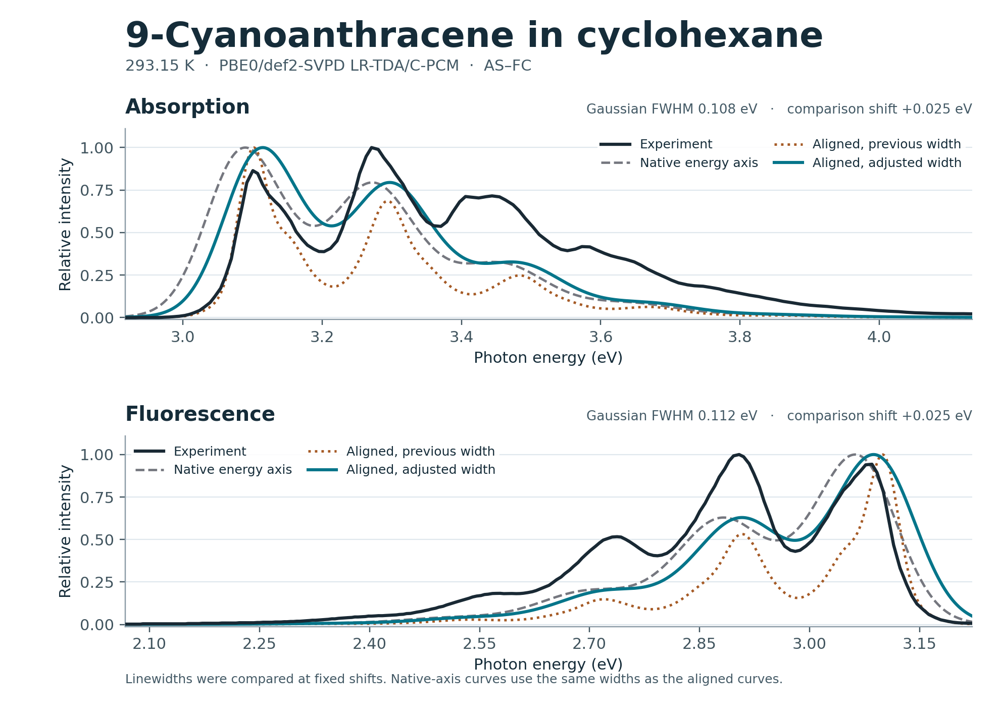

# PySCF ESD

**Vibronic absorption and fluorescence from PySCF.** Start with an XYZ geometry for an automatic calculation, or supply electronic surfaces and transition dipoles to the Python solvers.

[](pyproject.toml)
[](https://pyscf.org/)
[](LICENSE)
[](docs/paper/pyscf-esd.pdf)

**[Quick start](#quick-start) · [Default and options](#default-and-options) · [Spectra gallery](#spectra-gallery) · [Output](#output) · [Methods paper](#methods-paper)**

## Quick start

Use Python 3.10 or later on Linux or Windows Subsystem for Linux.

```bash
git clone https://github.com/HenriqueCSJ/PySCF_ESD.git
cd PySCF_ESD
python -m venv .venv
source .venv/bin/activate
python -m pip install '.[workflow]'
pyscf-esd molecule.xyz --output molecule.esd
```

Replace `molecule.xyz` with a single XYZ geometry in ångström. The output directory must be new. The CLI supports closed-shell singlets and accepts a molecular charge with `--charge`.

<details>
<summary><strong>Try a small water input</strong></summary>

```bash
cat > water.xyz <<'EOF'
3
Water, angstrom
O  0.0000000  0.0000000  0.0000000
H -0.7677654  0.0000000  0.5849831
H  0.7677654  0.0000000  0.5849831
EOF
pyscf-esd water.xyz --model vg --basis '6-31+g*' --output water-vg.esd
```

This example explicitly selects vertical gradient (VG) for a small installation check.

</details>

## Default and options

The default CPU workflow uses PBE0/def2-TZVPD and the first singlet LR-TDA root at the relaxed ground-state geometry. It targets both directions at 0 K, optimizes the two geometries with analytic gradients, follows the electronic root and transition-dipole phase, and checks restricted orbital stability. The automatic nuclear model builds an adiabatic harmonic reference and screens direct cuts for anharmonicity. A case outside the model or numerical coverage is reported as incomplete. For gas-phase RKS/TDA, the automatic route can use checked local fits to analytic gradients and signed dipoles for the excited-state curvature and dipole derivative.

<details open>
<summary><strong>Harmonic and faster models</strong></summary>

```bash
# Adiabatic Hessian with Duschinsky and linear Herzberg–Teller contributions
pyscf-esd molecule.xyz --model ah --temperature 298 --sigma 33.972872 --output ah-298.esd

# Vertical-gradient absorption sticks from the second singlet root at S₀
pyscf-esd molecule.xyz --model vg --process absorption --state 2 --sigma 0 --output vg-s2.esd
```

AH uses the two endpoint curvatures and includes Duschinsky rotation and coherent Franck–Condon/Herzberg–Teller amplitudes in the supported route. VG uses the ground-state curvature and the vertical excited-state gradient with a constant transition dipole. The CLI Gaussian setting is a standard deviation in cm⁻¹. The first command above uses **80 cm⁻¹ FWHM**. The default `--sigma 50` corresponds to about 118 cm⁻¹ FWHM.

</details>

<details>
<summary><strong>Reference checks and numerical controls</strong></summary>

- Select the electronic model with `--xc`, `--basis`, `--charge`, and one-based `--state`.
- Choose `--reference-checks all` to check the restricted reference at every electronic point. The default checks the relevant minima.
- Repeat `--fallback-xc XC` to specify ordered functional alternatives for the supported stability recovery path. Each functional starts a separate calculation. Inspect the resulting state assignment.
- Set `--process`, `--temperature`, `--max-quanta`, and `--max-overlaps` to control the desired spectrum and its vibrational budget. Run `pyscf-esd --help` for the accepted flags.

</details>

<details>
<summary><strong>Prepared inputs, anharmonicity and NVIDIA GPU</strong></summary>

- The [Python API](src/pyscf_esd/__init__.py) accepts prepared harmonic surfaces, supports periodic DVR with harmonic spectators at finite temperature, and exposes oscillator strengths and radiative properties.
- Automatic local anharmonic corrections qualify at 0 K. A periodic rotor at finite temperature uses supplied phase-consistent torsional inputs and the [separable rotor example](examples/assemble_separable_rotor.py).
- The [CF₃NO replay](examples/replay_cf3no_thermal.py) defaults to the retained PBE0/TDA model with one rotor and 11 spectators. SF-TDA is an explicit `--method sf-tda` alternative with Matplotlib for plotting. Both routes require the retained calculation archive, which is separate from this repository. The PBE0 comparison is a nuclear-model diagnostic with a restricted-reference instability.
- The [GPU module](src/pyscf_esd/gpu.py) provides a Python VG route with a compatible [GPU4PySCF](https://github.com/pyscf/gpu4pyscf) installation. Prepared isolated solvated DF-RKS/TDA roots also have [analytic excited-state curvature](src/pyscf_esd/molecular_tda_hessian.py) and [analytic transition-dipole response](src/pyscf_esd/tda_dipole.py) under their documented restrictions.
- The analytic curvature route needs fourth derivatives for the selected semilocal XC components. If the LibXC build bundled with PySCF lacks them, set `PYSCF_ESD_LIBXC_LXC` to a same-version LibXC shared library built with `MAXORDER=4`.

</details>

## Spectra gallery

The plots use photon energy in eV. The linewidth comparisons hold the prior energy shifts fixed and use the measured spectral windows. Fluorescence sampled per wavelength is treated as a wavelength density and converted to an energy density. Pyridine and quinine retain the absolute absorption scale. The solution benchmarks used prepared PySCF endpoints. Experimental curves and the ORCA comparator were replotted from the cited sources. The fitted comparison widths leave the software defaults and computed transition strengths unchanged.

<details open>
<summary><strong>Benzene · n-hexane · harmonic and anharmonic models</strong></summary>

<p>
  
</p>


The PBE anharmonic model reproduces the three main fluorescence bands and reduces the profile RMSE by **38%** relative to the harmonic control at the same width. With the comparison Voigt widths adjusted, the PBE anharmonic RMSE is **0.063** in absorption and **0.081** in fluorescence, versus **0.085** and **0.071** for the published ORCA curves. The archived mixed diagnostic gives a fluorescence RMSE of **0.074** and a smaller area-distribution error than ORCA. It combines force fields and assumes limiting front-face collection. Each model uses the same shift for both directions: **−0.239 eV** for harmonic PBE, **−0.241 eV** for anharmonic PBE and **−0.329 eV** for the mixed diagnostic. [de Souza et al., Fig. 3](https://doi.org/10.1063/1.5010895)

</details>

<details>
<summary><strong>Quinine dication · water · AS–Franck–Condon</strong></summary>

<p>
  
</p>


The broadened absorption maximum is **3.606 eV** before alignment, compared with **3.568 eV** in the experiment. A display shift of **−0.496 eV** brings the calculated fluorescence envelope close to the measured one. The unshifted peak separation in the energy-domain plot is **0.41 eV**, compared with **0.85 eV** measured. Retesting the widths retained **0.496 eV** for absorption and **0.397 eV** for fluorescence. The 50-atom pilot used one conformer in implicit water. Its relaxed S₁ geometry met the force criterion and gave stable successive spectra. The strict geometry convergence cycle was incomplete. [PhotochemCAD measurement in 0.5 M aqueous H₂SO₄](https://omlc.org/spectra/PhotochemCAD/html/081.html)

</details>

<details>
<summary><strong>9-Cyanoanthracene · cyclohexane · AS–Franck–Condon</strong></summary>

<p>
  
</p>



Holding the common shift at **+0.025 eV** and widening the Gaussian FWHM from **0.050 eV** to **0.108 eV** for absorption and **0.112 eV** for fluorescence lowers the profile errors by about **23%** and **27%**, respectively. The red absorption band still carries too much relative intensity. Equal curvatures and prepared endpoints define the AS model. [Boens et al., supporting Fig. S1-D, CC BY-NC 4.0](https://doi.org/10.1021/ac062160k.s001)

</details>

<details>
<summary><strong>Pyridine · vapor · AH + Duschinsky + Herzberg–Teller</strong></summary>

<p>
  
</p>


The local harmonic origin is **4.217 eV** versus **4.311 eV** measured. The comparison retains Gaussian FWHM values of **0.010** and **0.020 eV**, with display shifts of **−0.127** and **+0.356 eV** for absorption and fluorescence. A shallow out-of-plane well and evolving electronic character limit the local model. [Experimental vibronic origin](https://doi.org/10.1016/j.cplett.2008.07.080) · [Absorption](https://doi.org/10.1016/0022-2852(84)90051-1) · [Fluorescence trace](https://doi.org/10.1063/1.433862) · [Traced through Wang et al.](https://doi.org/10.1021/acs.jpclett.2c01475)

</details>

## Output

Open `diagnostics.json` first. It records the effective method, convergence and state checks, vibrational coverage, and the reason for any incomplete result. When available, the CLI writes assigned absorption and emission sticks, Gaussian profiles, and `properties.json` with oscillator strengths, vacuum radiative rates, spectral moments and peak separation. Partial outputs are labeled accordingly. A vacuum radiative lifetime describes spontaneous emission on the modeled surfaces. Experimental fluorescence lifetimes and yields also depend on nonradiative processes.

## Methods paper

Read the [companion mini-article (PDF)](docs/paper/pyscf-esd.pdf) or its [LaTeX source](docs/paper/main.tex). It describes the electronic and vibronic approximations and compares their predictions with experimental spectra. The [ORCA fluorescence paper](https://doi.org/10.1063/1.5010895) provides the methodological context.

Build the article from its source with `latexmk -cd -pdf docs/paper/main.tex`.

## Develop

```bash
python -m pip install -e '.[workflow]'
python -m unittest discover -s tests
```

[GNU GPL v3.0 only](LICENSE).
