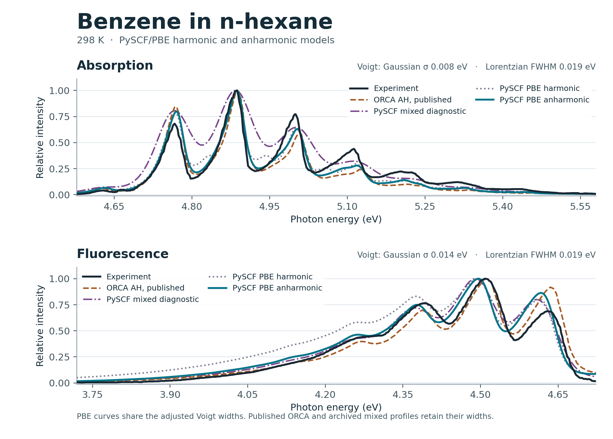
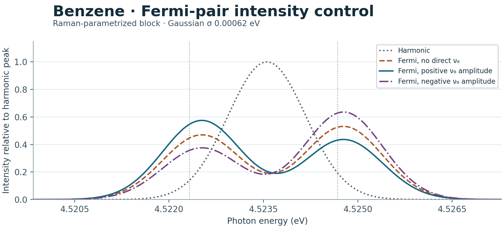
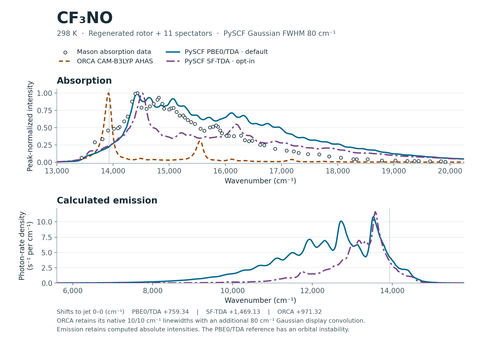
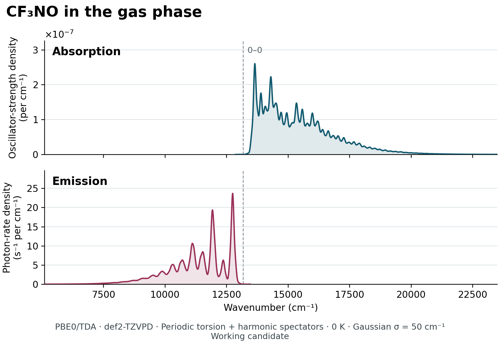
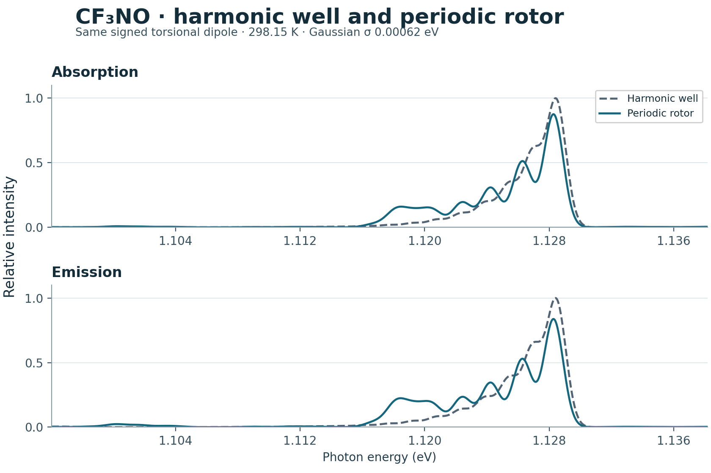
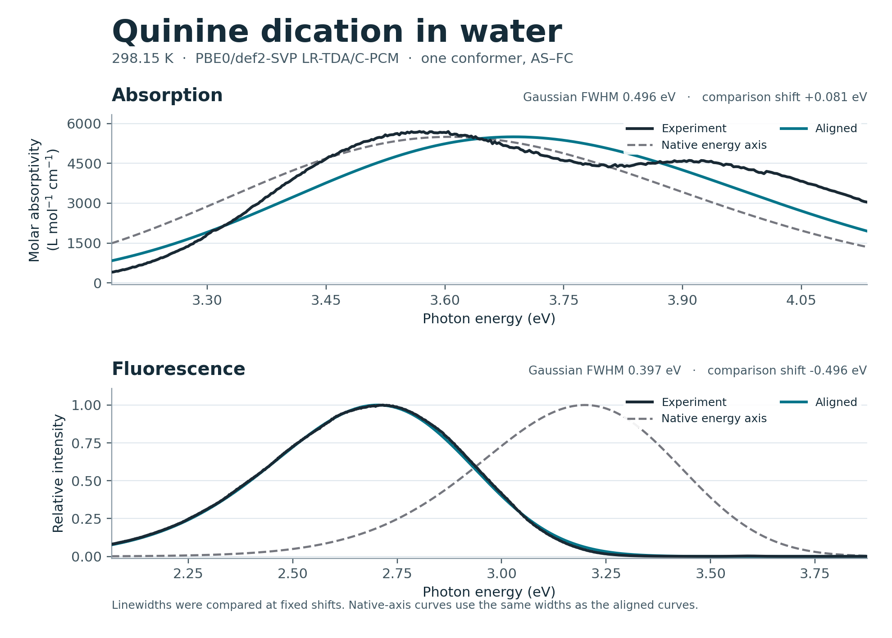
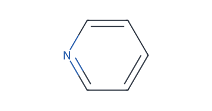
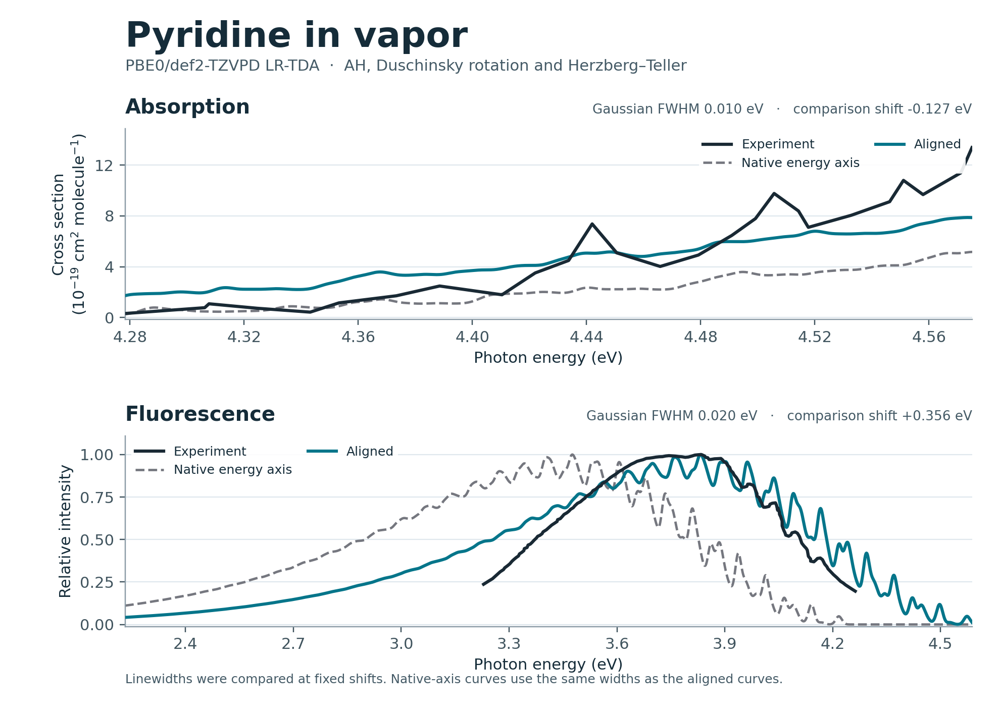
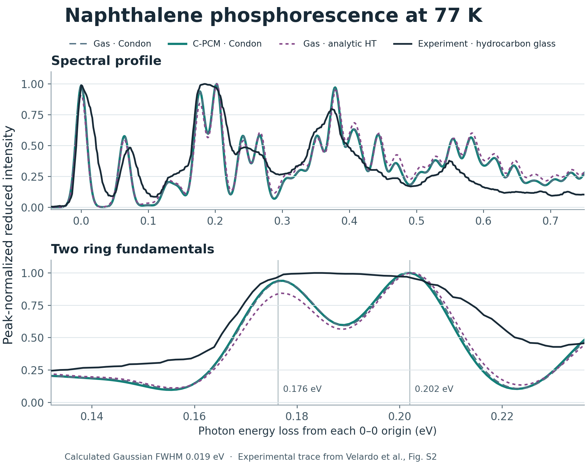

# PySCF ESD

**Vibronic absorption, fluorescence, and phosphorescence with PySCF**

PySCF ESD follows an electronic state from a molecular geometry to a spectrum with assigned vibrational lines, transition strengths, and radiative lifetimes. Run the closed-shell singlet workflow from an XYZ file, call it from an existing PySCF script, or assemble spectra from your own electronic surfaces and transition moments.

[](pyproject.toml)
[](https://pyscf.org/)
[](LICENSE)
[](docs/paper/pyscf-esd.pdf)

**Run** · [Install and run](#quick-start) · [PySCF module](#use-as-a-pyscf-module) · [Choose a model](#default-and-options) · [Read results](#output)

**Methods** · [Absorption and fluorescence](#absorption-and-fluorescence) · [Phosphorescence](#phosphorescence) · [Electronic structure and GPU](#electronic-structure-and-gpu) · [Nuclear dynamics](#nuclear-dynamics)

**Evidence** · [Spectra gallery](#spectra-gallery) · [Reproduce and extend](#reproduce-and-extend) · [Methods paper](#methods-paper)

## What PySCF ESD does

- **Track the same state through relaxation.** The optimizer follows signed transition-density overlaps across changing orbital bases. Separate checks test SCF stability, response residuals, stationarity, and vibrational curvature.
- **Explain band intensities.** Adiabatic Hessian (AH) uses the two relaxed minima, their separate curvatures, Duschinsky mode mixing, and coherent Franck–Condon (FC) and Herzberg–Teller (HT) amplitudes. Vertical gradient (VG) gives a lower-cost shared-curvature model.
- **Choose the nuclear model.** Screen for local anharmonicity automatically, or supply a periodic rotor, a coupled double well, or a vibrational resonance. Prepared rotor calculations can use a torsion-dependent signed dipole and a harmonic spectator bath at finite temperature.
- **Calculate spin-dependent emission.** Prepared UKS/TDA and SF-TDA provide open-shell optical properties. Spin–orbit state interaction and full-space first-order response supply polarized phosphorescence, including gas-phase analytic spin-vibronic HT.
- **Export the underlying physics.** Get assigned sticks, broadened spectra, absolute oscillator strengths, radiative rates, lifetimes, relaxation energies, and mode-resolved contributions. The report records how each total was qualified.

The benchmarks show what changes when the model changes. In CF₃NO, a periodic rotor restores the progression missed by the published harmonic treatment. In benzene, geometry and coherent HT amplitudes change different parts of the fluorescence spectrum. In naphthalene, full-space spin–orbit response recovers the dominant perpendicular emission. [Benchmarks and spectra](#spectra-gallery)

## Quick start

Use Python 3.10 or later on Linux or WSL. Clone the repository and install the workflow dependencies.

```bash
git clone https://github.com/HenriqueCSJ/PySCF_ESD.git
cd PySCF_ESD
python3 -m venv .venv
source .venv/bin/activate
python -m pip install '.[workflow]'

pyscf-esd examples/water.xyz --model vg --basis '6-31+g*' --output water.esd
```

The [bundled water input](examples/water.xyz) exercises VG with a small basis. Look for `properties.json`, `diagnostics.json`, and the absorption and emission CSVs in `water.esd/`.

```bash
pyscf-esd molecule.xyz --output run.esd
pyscf-esd --help
```

Supply one closed-shell molecular geometry in ångström and a new output directory. The input atom order carries through to the reported modes and derivatives. The full CPU default was exercised on LiH from XYZ through both spectra. Its small input and expected output are in the [CPU default check](docs/validation.md#cpu-default-from-xyz). [Installation and command-line options](docs/guide.md)

## Use as a PySCF module

```python
from pyscf import esd, gto

mol = gto.M(atom="examples/water.xyz", basis="6-31+g*", unit="Angstrom")
result = esd.run(mol, xc="pbe0", model="vg")

report = result.physical_properties["spectra"]
print("Integrated absorption", report["absorption"]["population_weighted_oscillator_strength_sum"])
print("Rate convergence", report["emission"]["positive_photon_moments"]["M3"]["status"])
```

`esd.run` uses the geometry, named basis, and charge of a built PySCF molecule. Supply real atoms, spherical all-electron basis functions, and `spin=0` for the automatic singlet route. Choose `target_index=1` for the second singlet in Python, or `--state 2` on the CLI. Indices follow the roots at relaxed S₀ and the optimizer tracks the assigned state from there.

Use `esd.Settings` with `esd.run_vibronic` to control the initial root count, grid level, and SCF or response tolerances. This entry point takes Cartesian coordinates in bohr. Lower-level APIs accept derivatives, normal modes, dipoles, and model Hamiltonians from prepared data. [Python API](docs/api.md) · [Settings and units](docs/using-methods.md#choosing-the-level-of-theory)

## Default and options

The default is **CPU · PBE0/def2-TZVPD · first singlet at the relaxed S₀ geometry · 0 K · absorption and emission · `auto`**. `auto` starts with the two relaxed surfaces, screens direct electronic cuts, and selects harmonic AH or a qualified local anharmonic model. A failed qualification gives an incomplete result with its reason.

| What you want to run | Entry point | Vibrational model or input |
| --- | --- | --- |
| Automatic two-surface calculation | `--model auto` or `esd.run(mol)` | AH with local anharmonic screening |
| Harmonic limit at two minima | `--model ah` | Separate curvatures, Duschinsky, FC + linear HT |
| Fast shared-curvature spectrum | `--model vg` | S₀ Hessian and vertical S₁ gradient, constant dipole in the CLI |
| Analytic GPU calculation in vacuum or solution | `--backend gpu --model ah` with optional `--solvent` | Global-hybrid LR-TDA, equilibrium C-PCM when a solvent is supplied |
| AS, FC-only, or a Duschinsky control | `esd.harmonic_spectrum` or `esd.run_prepared_ah` | Caller-supplied curvatures, coordinate map, and dipoles |
| Explicit central differences at a supplied geometry | `esd.run_cpu_vibronic` | Opt-in numerical HT slopes or excited-state curvature |
| Thermal rotor, double well, or Fermi resonance | [Prepared nuclear models](#prepared-rotors-double-wells-and-resonances) | Potentials and signed dipoles in selected coordinates |
| UKS/TDA and SF-TDA | [Open-shell spectra](#open-shell-spectra-and-spin-flip) | Prepared unrestricted reference or spin-flip roots |
| Triplet phosphorescence | [Phosphorescence](#phosphorescence) | Singlet–triplet SOC and prepared vibronic data |

### Choose the functional, basis, state, and solvent

```bash
# Choose the functional, basis, temperature, and linewidth
pyscf-esd molecule.xyz --model ah --xc b3lyp --basis def2-SVP \
  --temperature 298 --sigma 33.972872 --output ah-298.esd

# Second singlet, absorption sticks, no broadening
pyscf-esd molecule.xyz --state 2 --model vg --process absorption \
  --sigma 0 --output s2-absorption.esd

# Analytic GPU AH in equilibrium C-PCM
pyscf-esd molecule.xyz --backend gpu --model ah --xc pbe0 --solvent cyclohexane \
  --temperature 298 --output gpu-solution.esd
```

- `--xc` and `--basis` accept PySCF names. CPU supports compatible LDA/GGA and hybrids, including range-separated functionals with the required XC derivatives. The automatic GPU backend requires a global hybrid. Both require supported all-electron references.
- `--charge 2` requests a closed-shell dication. `--state 2` selects the second singlet at the relaxed S₀ geometry. The Python equivalent is `target_index=1`.
- `--solvent` selects a named equilibrium C-PCM solvent on the GPU backend. The solvent affects the electronic surfaces and response. `--temperature` sets the Boltzmann populations of the initial vibrational surface for each direction.
- `--sigma` is the Gaussian standard deviation in cm⁻¹. A value of 33.972872 gives 80 cm⁻¹ FWHM (0.00992 eV). Use `--sigma 0` for sticks. The default is 50 cm⁻¹. The adaptive solver targets 99.5% coverage with ceilings of 32 quanta and 250,000 overlaps. Change the ceilings with `--max-quanta` and `--max-overlaps`.

[Level of theory](docs/using-methods.md#choosing-the-level-of-theory) · [Solvent and dielectric settings](docs/using-methods.md#choosing-a-solvent) · [CLI options](docs/guide.md#command-line-options)

## Electronic structure and GPU

### Geometry optimization, state identity, and stability

1. **Prepare the ground reference.** Optimize S₀ with analytic gradients and check the closed-shell self-consistent solution. SCF retries can reuse projected orbitals or use a fresh solve. Independent residuals qualify the result.
2. **Follow the excited state.** Transition-density overlap across the two AO bases determines the state correspondence and sign. The excited-state optimizer uses analytic gradients, checks the local root window, and records the electronic identity through the optimization.
3. **Verify the endpoint.** Check stationarity and the projected vibrational curvatures. A geometry that looks chemically reasonable can still sit on a saddle or a different electronic root.
4. **Handle orbital instabilities.** The stability checks distinguish an internal RKS saddle from instability toward spin breaking. An internal recovery follows the unstable rotation and verifies a lower, stable solution. A spin-breaking failure can trigger an explicitly selected alternative functional, starting the full workflow again. Each attempt records its actual electronic method and state.
5. **Qualify the spectrum.** Grow the vibrational basis to check initial population and final dipole-strength coverage. The adaptive harmonic route also bounds the omitted positive-photon contributions to oscillator strength, radiative rate, and radiant power. An incomplete run reports the limiting check and can retain partial data for inspection.

The default checks orbital stability at the minima. Use `--reference-checks all` to extend the checks to sampled points. Repeat `--fallback-xc XC` to allow ordered, explicit restarts after spin-breaking instability. Each new functional gets its own state assignment at the relaxed ground geometry. [Stability, recovery, and root tracking](docs/methods.md#electronic-reference-and-state-tracking)

The optimizer uses projected Cartesian BFGS with analytic gradients. A trial must pass the electronic checks and a downhill energy test after alignment. Failed trials shorten the step. The optimizer can restart with steepest descent, and the endpoint check can follow a downhill direction from a stationary point with negative curvature. The diagnostics count electronic and energy rejections separately. [Optimizer and minimum checks](src/pyscf_esd/electronic_workflow.py)

### Analytic derivatives by route

- **CPU VG.** Uses the analytic ground-state Hessian and excited-state gradient at S₀ without finite-difference derivative samples. The matched water control verified the S₁ response at the requested tolerance of 10⁻¹⁰.
- **CPU DFT AH.** Uses analytic gradients, the analytic S₀ curvature, and checked local fits to displaced S₁ gradients and signed dipoles for excited-state curvature and HT. An optional fixed-geometry CPU API provides explicit central differences with signed root tracking and checkpointed samples.
- **CPU RHF–CIS controls.** Conventional real, all-electron singlet CIS supports analytic S₁ Hessian and dipole derivatives. LiH and formaldehyde qualify this route against independent checks. These retained controls are distinct from the DFT workflow.
- **GPU VG, AH, and automatic screening.** GPU VG supplies the analytic reference curvature and gradient. Supported GPU AH computes the two Hessians and phase-matched HT derivative analytically. `auto` can use the GPU for direct potential and dipole samples in the nuclear anharmonic model. Parts of assembly and the nuclear solver run on the host.
- **Prepared GPU LR-TDA, vacuum or equilibrium C-PCM.** The analytic Hessian includes orbital and TDA root response, auxiliary-basis and density-fitting derivatives, moving XC quadrature, fourth-order semilocal XC terms, and the matching solvent response where applicable. The dipole derivative includes the occupied and excitation response in the tracked electronic phase.

GPU `vg`, `ah`, and `auto` use GPU4PySCF and require a supported global hybrid built from LDA/GGA components, such as PBE0, and a spherical all-electron basis. Install GPU4PySCF for your CUDA environment before running these models. AH and `auto` also require fourth-order XC derivatives. PBE0 has a built-in analytic expression. Other compatible functionals can require a matching LibXC build selected via `PYSCF_ESD_LIBXC_LXC`. A rejected GPU derivative is recorded as a workflow failure. [GPU setup and supported routes](docs/using-methods.md#gpu-vg-ah-and-automatic-screening) · [Prepared analytic C-PCM derivatives](docs/using-methods.md#analytic-derivatives-for-prepared-c-pcm-roots)

### Opt into central differences on CPU

Use the fixed-geometry Python route to differentiate signed dipoles or analytic excited-state gradients. Supply a stationary S₀ geometry. Existing samples may be reused via `checkpoint_dir`.

```python
from pyscf import esd

def numerical_response(symbols, coordinates_bohr):
    return esd.run_cpu_vibronic(
        symbols, coordinates_bohr, esd.Settings(basis="def2-SVP", xc="pbe0"),
        target_index=0, include_ht=True, compute_excited_hessian=True,
        step_bohr=0.005, checkpoint_dir="fd-checkpoints",
    )
```

The spectrum from this object uses VG curvatures. Its optional excited-state Hessian is evaluated at the supplied S₀ geometry. The relaxed S₁ Hessian needed for AH comes from the two-minimum route. [Central-difference inputs and outputs](docs/using-methods.md#explicit-central-differences-on-cpu)

### Prepared electronic endpoints

The response functions work with solved, isolated singlet TDA roots at their corresponding geometries. Pass the same tracked excited state at both endpoints.

```python
from pyscf import esd

def endpoint_response(td_at_s0, root_at_s0, td_at_s1, root_at_s1, phase_at_s0):
    curvature = esd.analytic_molecular_tda_hessian(td_at_s1, root_at_s1)
    dipole = esd.analytic_tda_transition_dipole(td_at_s0, root_at_s0, phase=phase_at_s0)
    return curvature, dipole
```

The Hessian is the total excited-state Hessian. The excitation energy and gradient are corrections to the matching restricted reference at S₁. Use `esd.adiabatic_hessian` to combine the two endpoint energies, gradients, and Cartesian Hessians. It removes relative translation and rotation, projects the vibrational spaces, and returns the normal modes, Duschinsky map, and 0–0 energy. Project the Cartesian dipole derivative onto the signed modes before passing it to `esd.run_prepared_ah`. [Prepared C-PCM derivatives](docs/using-methods.md#analytic-derivatives-for-prepared-c-pcm-roots) · [Complete AH assembly example](docs/using-methods.md#spectra-from-prepared-electronic-data)

## Absorption and fluorescence

The automatic singlet workflow computes absorption from S₀ and fluorescence from the selected excited surface. Use `--process absorption`, `--process emission`, or `--process both`. For fluorescence, AH relaxes the tracked emitting state and evaluates its own curvature. VG uses the displaced minimum defined by its shared-curvature approximation.

```bash
pyscf-esd molecule.xyz --model ah --process emission --temperature 298 \
  --sigma 33.972872 --output fluorescence.esd
```

### Harmonic vibronic amplitudes

AH relates the two sets of mass-weighted coordinates by $Q_1=JQ_0+K$. The rotation $J$ mixes modes, and $K$ describes their displacement. The 0–0 gap includes both the difference between the electronic minima and the differential zero-point energy. The FC term comes from the vibrational overlap with the constant dipole. The HT term comes from the signed first-order variation of the dipole along the modes. The amplitudes add before squaring, so the report can resolve FC, HT, and their interference.

$$
\mathbf{M}_{if} = \boldsymbol{\mu}_0\langle f\mid i\rangle + \sum_k \left(\frac{\partial\boldsymbol{\mu}}{\partial Q_k}\right)_0 \langle f\mid Q_k\mid i\rangle
$$

Here $i$ and $f$ are the initial and final vibrational states, $Q_k$ is an initial normal coordinate, and $\boldsymbol{\mu}_0$ is the signed electronic transition dipole at the expansion geometry. An FC-only calculation omits the slopes. Use a consistently mapped identity $J$ to isolate the effect of Duschinsky rotation. To build an adiabatic shift (AS) model, use the two relaxed geometries and a shared curvature in a common frame. [Prepared harmonic controls](docs/using-methods.md#spectra-from-prepared-electronic-data)

The absorption calculation starts on S₀. Fluorescence starts on the relaxed emitting surface, reverses the Duschinsky transformation, and uses that surface's thermal populations. Absorption oscillator strengths carry one power of photon energy. Spontaneous photon rates carry three. These differences affect spectral shape, dominant lines, and the Stokes separation.

`harmonic_spectrum` returns assigned sticks from the selected basis. `thermal_harmonic_spectrum` evaluates broadened all-quanta FC/HT profiles with a characteristic function, including complex input amplitudes for spin–orbit spectra. It can return reduced dipole-strength density for comparison and the separate photon-weighted moment needed for absolute rates. [Harmonic theory and API](docs/methods.md#harmonic-vibronic-model) · [Thermal profiles](docs/numerical-results.md#thermal-profiles-and-prepared-rotors)

## Nuclear dynamics

### Automatic local anharmonicity at finite temperature

- **One-mode DVR.** Direct samples on both surfaces determine a one-dimensional potential and signed dipole. The solver checks the finite-grid partition against a finer grid and a larger domain and checks confinement below the sampled well walls.
- **Local VCI.** Available cubic and quartic couplings enter a variational vibrational Hamiltonian. Fit holdouts, changes in basis size, and changes in the taper test the retained energies and states. At positive temperature the solver orders states by energy and bounds omitted Boltzmann weight.
- **Spectral coverage.** Initial thermal population and final dipole-strength closure are independent checks. Absorption and emission can reach different coverage under the same budget. Low barriers, competing minima, or strong couplings can require an explicitly prepared nuclear model.

```bash
pyscf-esd molecule.xyz --model auto --temperature 298 --process both \
  --output thermal-auto.esd
```

[Finite-temperature qualification](docs/using-methods.md#finite-temperature-anharmonicity) · [Automatic VCI implementation](src/pyscf_esd/automatic_anharmonic.py) · [One-mode implementation](src/pyscf_esd/automatic_1d.py)

### Prepared rotors, double wells, and resonances

**Periodic rotor with spectators.** Use two torsional potentials on a common energy zero and a signed vector transition dipole along the angle. The periodic DVR treats each surface with its own constant inertia. Signed state links around the full path determine closure. The code supports periodic and antiperiodic nuclear boundary conditions and checks the corresponding dipole parity. Rigid rotation is removed from the spectator mapping before combining harmonic spectator states with the rotor. This separates large-amplitude torsion from the other normal modes while retaining finite temperature, direction-specific populations, and spectator mode mixing.

```bash
# Synthetic rotor, with its own analytic checks and no electronic inputs
python examples/validate_anharmonic_rotor.py

# Molecular rotor from a caller-supplied phase-tracked archive
python -m pip install matplotlib
python examples/assemble_separable_rotor.py cuts.json --output rotor-298 \
  --temperature 298 --fwhm 80 --dvr-grids 256 512
```

**Double wells.** The prepared two-dimensional sine Galerkin and three-dimensional sine DVR solvers use sampled potentials in mass-weighted coordinates. Reflection-even and reflection-odd states can be separated and contracted with a coordinate-dependent dipole. The formaldehyde example includes the relaxed planar direction alongside inversion and distinguishes an electronic barrier from a separation between eigenstates.

**Fermi resonance.** `mix_vibrational_states` diagonalizes a supplied vibrational block and rotates signed Cartesian amplitudes with its eigenvectors. This gives intensity borrowing and coherent interference between a bright combination and a directly active fundamental. Prepared benzene examples compare a harmonic reference, a coupled three-mode model, removal of the cubic resonant term, and the effect of spectator couplings.

[Periodic rotor API and runnable Python example](docs/using-methods.md#thermal-torsion) · [Coupled-mode APIs](docs/api.md#reduced-coupled-vibrational-models) · [Vibrational state mixing](src/pyscf_esd/vibrational_mixing.py)

## Open-shell spectra and spin flip

- **Prepared unrestricted DFT.** `analytic_uks_triplet_endpoint` returns the energy, analytic gradient, optional fixed-quadrature Hessian, orbital residual, and ⟨S²⟩ of a converged high-spin triplet. The supported gas-phase LDA/GGA route can use CPU PySCF or GPU4PySCF. Use consistent quadrature conventions when comparing geometries and curvatures.
- **Spin-conserving optical spectra.** `unrestricted_tda_vertical_spectrum` gives absorption or reverse emission from assigned UKS/TDA roots. It uses the reference's $M_S$ sector and exposes the reference spin diagnostic. The native unrestricted root's total spin requires a separate assignment.
- **Spin-flip TDA.** `solve_spin_flip_tda` starts from a converged high-spin GPU UKS reference. It exposes fixed-geometry root energies, orbital-relaxed interstate dipoles, and analytic state gradients through `spin_flip_tda_gradient`. Differences of the physical-root energies give the optical gap. A geometry-to-spectrum spin-flip workflow uses caller-tracked states, qualified curvatures, and the prepared spectral API.

[Open-shell and triplet APIs](docs/phosphorescence.md) · [Spin-flip Python examples and index conventions](docs/using-methods.md#spin-flip-tda-on-gpu)

## Phosphorescence

Phosphorescence here is triplet-to-singlet emission enabled by spin–orbit coupling. Start from prepared electronic states at the emitting geometry. For a vibronic spectrum, also supply both relaxed surfaces and the triplet-to-singlet 0–0 energy. The [phosphorescence guide](docs/phosphorescence.md) follows the calculation from the electronic input to a thermal spectrum and polarized rates.

### Spin–orbit intensity borrowing

The explicit state-interaction route builds molecular Breit–Pauli spin–orbit mean-field and interstate length-gauge dipoles from PySCF integrals. It mixes selected singlets and the three Cartesian spin components of each retained triplet. The result includes the mixed moments, sublevel-resolved radiative rates, and the population-weighted rate for a supplied temperature. With prepared matrix derivatives, `spin_orbit_dipole_derivatives` differentiates the coherently mixed moments.

```python
from pyscf import esd

def vertical_phosphorescence(rks_at_triplet_minimum):
    matrices = esd.run_pyscf_tda_soc(
        rks_at_triplet_minimum, n_singlets=12, n_triplets=12,
    )
    return matrices.phosphorescence(triplet_root=0, temperature_kelvin=77)
```

For weak SOC, `tda_soc_response` solves for singlet and triplet intensity borrowing over the occupied–virtual space. It checks that the target triplet eigenpair is converged and that the shifted operators have the required spectral margins, including directions that can be dark to the optical response. The two borrowing paths add coherently.

The gas-phase HT route differentiates the spin–orbit and dipole integrals, relaxed orbitals and density, both response operators, and the isolated lowest triplet. This first-order model uses the spin-free triplet degeneracy. Use `run_prepared_phosphorescence` when supplying state-interaction results and AH data. Use the [full-space profile example](docs/phosphorescence.md#full-space-first-order-soc-and-analytic-herzbergteller-coupling) to combine the analytic moments and slopes with a finite-temperature harmonic profile.

The SOMF implementation contracts Coulomb and exchange terms directly over AO shells. The derivative path batches nuclear directions and checks the individual orbital-response residuals. Projected adjoints supply the root and response changes needed for dipole slopes. The calculation evaluates those terms at one geometry. [SOMF derivative implementation](src/pyscf_esd/somf_derivatives.py) · [Orbital and TDA response](src/pyscf_esd/tda_nuclear_response.py)

[Explicit SOC assembly](docs/phosphorescence.md#automatic-soc-and-interstate-dipoles) · [Full-space response and thermal spectrum](docs/phosphorescence.md#full-space-first-order-soc-and-analytic-herzbergteller-coupling) · [Prepared vibronic phosphorescence](docs/phosphorescence.md#prepared-vibronic-phosphorescence)

### Get the phosphorescence spectrum and lifetime

Pass a prepared AH model and a `PhosphorescenceResult` from SOC state interaction to `run_prepared_phosphorescence`. The example below uses constant mixed dipoles. Supply `dipole_derivatives_au` in the triplet normal coordinates to include linear spin-vibronic HT.

```python
from pyscf import esd

def vibronic_phosphorescence(ah_parameters, soc_result, origin_hartree):
    result = esd.run_prepared_phosphorescence(
        ah_parameters, soc_result,
        lowest_sublevel_00_hartree=origin_hartree, temperature_kelvin=77,
    )
    report = result.physical_properties
    print("Radiative rate (s^-1)", report["vacuum_radiative_rate_s_inverse"])
    print("Radiative lifetime (s)", report["vacuum_radiative_lifetime_s"])
    return result
```

`result.sublevel_spectra` contains the assigned sticks for each triplet sublevel. `result.sublevel_populations` contains their thermal weights. `result.physical_properties` includes the sublevel 0–0 energies and contributions to the total rate. [Naphthalene phosphorescence benchmark](#phosphorescence-benchmark)

## Output

### Files from the command line

| File | What it contains |
| --- | --- |
| `diagnostics.json` | Run status, requested and effective method, state tracking and phase, derivative route, and coverage by direction |
| `properties.json` | Numerical observables from the retained transitions and diagnostics available for the chosen model |
| `absorption_sticks.csv`, `emission_sticks.csv` | Assignments, energies, populations, signed Cartesian dipoles where available, and line oscillator strengths or Einstein A coefficients |
| `absorption_profile.csv`, `emission_profile.csv` | Optional Gaussian-broadened relative photon-weighted density per cm⁻¹ |

When the workflow records an incomplete result, the CLI exits with code 2. Check `diagnostics.json` first. Available partial sticks and profiles carry `_partial` in the filename. In Python, catch `esd.WorkflowIncomplete` and inspect `error.diagnostics` and `error.partial_spectra`. If a vibrational budget stopped the calculation, use the reported population, dipole closure and omitted-moment bounds to identify which cutoff limited the result. [Troubleshooting](docs/guide.md#troubleshoot-an-incomplete-result)

### Read fluorescence rates and line strengths

```python
import json
from pathlib import Path

report = json.loads(Path("water.esd/properties.json").read_text(encoding="utf-8"))
emission = report["spectra"].get("emission", {})
rate_status = emission.get("positive_photon_moments", {}).get("M3", {}).get("status", "unavailable")
print("Radiative rate convergence", rate_status)
if rate_status == "complete":
    print("k_f (s^-1)", emission["vacuum_radiative_rate_s_inverse"])
    lifetime = emission["vacuum_radiative_lifetime_s"]
    if lifetime is not None:
        print("Radiative lifetime (ns)", 1e9 * lifetime)
```

The same report is available as `result.physical_properties`. The vacuum rate is $k_f=\sum_i p_i\sum_f A_{if}$, where $p_i$ is the population of emitting vibrational state $i$ and $A_{if}$ is the Einstein A coefficient. The reciprocal of a positive rate gives the model radiative lifetime. The vacuum prefactor also applies to C-PCM electronic data. Measured decay times and quantum yields additionally depend on nonradiative channels.

`positive_photon_moments` reports convergence separately for integrated oscillator strength (`M1`), radiative rate (`M3`) and radiant power (`M4`). The adaptive harmonic route reports a lower bound on the fraction each retained sum represents. Other models may report `unassessed` and still provide a sum over the retained lines.

Where the model supplies them, the numerical reports include:

- Population-weighted oscillator strengths and dipole strengths, radiant power, and contributions from individual initial vibrational states.
- The 0–0 origin, strongest sticks, centroids, energy variances, and three distinguishable Stokes separations from the sticks or broadened peaks.
- The two vertical energies, adiabatic electronic gap, relaxation and deformation energies, and differential zero-point correction.
- Signed mode displacements, Huang–Rhys factors, mode-resolved reorganization energies, and the Duschinsky matrix.
- FC and HT strengths, signed interference, mean occupation of final modes, and their share of the signal.

### Plot a profile in eV

After running the quick start, install the optional plotting dependency with `python -m pip install matplotlib`. The conversion below puts both profiles on the native eV axis and rescales the density to preserve its area. For relative shapes, normalize the two directions separately because absorption and emission use different photon weights. To align a comparison, add the reported shift to the displayed energy axis and retain the native sticks and rate report.

```python
from pathlib import Path

import matplotlib.pyplot as plt
import numpy as np

cm_per_ev = 8065.54393734921
figure, axes = plt.subplots(2, 1, layout="constrained")
for ax, process in zip(axes, ("absorption", "emission"), strict=True):
    filename = Path("water.esd") / f"{process}_profile.csv"
    wavenumber, density = np.loadtxt(filename, delimiter=",", skiprows=1).T
    ax.plot(wavenumber / cm_per_ev, density * cm_per_ev)
    ax.set(title=process.capitalize(), xlabel="Photon energy (eV)", ylabel="Relative density per eV")
plt.show()
```

[Numerical schema, units, and examples](docs/numerical-results.md) · [Coverage and diagnostics](docs/guide.md#read-the-output)

## Spectra gallery

**[Absorption and fluorescence benchmarks](#absorption-and-fluorescence-benchmarks) · [Phosphorescence benchmark](#phosphorescence-benchmark) · [Numerical controls](#numerical-controls)**

The captions identify the model, linewidth, and energy reference. An aligned envelope tests band spacings and intensities. The native energy axis also tests absolute excitation and emission energies. Most gallery plots use eV. Selected archived controls retain their original axes. The [molecular structure plate](docs/paper/pyscf-esd.pdf#page=2) shows the nine systems in the methods paper.

### Numerical controls

<details>
<summary><strong>Water · matched CPU and RTX 4070 Laptop GPU</strong></summary>

Both PBE0/6-31+G* analytic VG paths produced **9,100 assigned lines in each direction** at 298.15 K and passed 16 numerical checks. The largest line-energy differences were **1.13 × 10⁻⁵ cm⁻¹** in absorption and **1.04 × 10⁻⁵ cm⁻¹** in emission. The maximum S₀ Hessian discrepancy was **7.04 × 10⁻¹¹ Hartree/bohr²**. Verification of a CPU orbital-response correction gave an S₁ residual of **8.51 × 10⁻¹¹** at the requested 10⁻¹⁰ tolerance. The production calculation uses analytic derivatives at the supplied ground geometry.

The warmed three-run medians were **21.37 s on two CPU threads** and **36.80 s on the RTX 4070 Laptop GPU**. For this system, a separate timing profile explained most of the extra GPU time through SCF/TDA setup, response validation, and orbital stability checks. The same benchmark measures both numerical agreement and wall time.

```bash
python examples/validate_water_cpu.py water-validation --threads 2
python examples/validate_water_gpu.py water-validation/reference.json \
  water-gpu-report.json --threads 2 --repeats 3
```

Add `--stencil` to the CPU control to compare the analytic gradient with independent displaced points. [Matched benchmark and tolerances](docs/validation.md#water-cpu-and-gpu)

</details>

<details>
<summary><strong>LiH · CPU default from XYZ</strong></summary>

CPU `auto` completed both spectra with PBE0/def2-TZVPD at 0 K. It optimized both surfaces, tracked the first singlet, and selected a direct one-mode DVR using 51 energy and dipole evaluations. The six retained sticks per direction cover **99.52%** and **99.83%** of the absorption and emission dipole strength. The report marks the energy-weighted moments `unassessed` for this anharmonic route. [Input and reproduction command](docs/validation.md#cpu-default-from-xyz)

</details>

<details>
<summary><strong>Formaldehyde · analytic AH, Duschinsky rotation, and inversion</strong></summary>

The RHF–CIS/6-31G(d) control compares the analytic polyatomic S₁ Hessian with independent gradient stencils. The maximum Cartesian discrepancy was **1.84 × 10⁻⁶ Hartree/bohr²**. Both harmonic profiles use the same signed linear HT model and Gaussian σ of 0.0062 eV. The matched-mode comparison holds the ground-frame displacement fixed while suppressing mode mixing.


The separate inversion calculation uses both symmetry-related S₁ wells and the transition dipole along the inversion coordinates. Adding a third coordinate to describe planar relaxation lowers the direct electronic barrier from **0.03459 to 0.01660 eV** (279.00 to 133.90 cm⁻¹). The lowest even–odd interval moves from **0.02785 to 0.02626 eV** (224.65 to 211.84 cm⁻¹). The lowest level is close to the effective transverse barrier. These intervals describe the coupled nuclear solutions. The odd dipole in the parity model gives an electrically dark even-to-even 0–0 line.


Both plots use retained curves with the photon-energy axis expressed in eV and one common intensity normalization within each panel. The vertical dotted line marks the 0–0 energy for the corresponding AH or 3D inversion model. [Analytic AH replay](examples/validate_h2co_analytic_ah.py) · [Two-coordinate inversion](examples/validate_h2co_inversion.py) · [Three-coordinate inversion](examples/validate_h2co_3d.py) · [Model and barrier definitions](docs/validation.md#formaldehyde-inversion)

</details>

### Absorption and fluorescence benchmarks

<details open>
<summary><strong>Benzene · n-hexane · geometry sensitivity and anharmonicity</strong></summary>

<p>
  
</p>



At 298 K the PBE anharmonic model reproduces the three main fluorescence bands and reduces peak-normalized profile RMSE from **0.131 to 0.081**. Its absorption RMSE is **0.063**. The two PBE models use a Voigt profile with Lorentzian FWHM **0.019 eV** and Gaussian σ **0.008 eV** for absorption or **0.014 eV** for fluorescence. Their respective harmonic and anharmonic shifts are **−0.239 eV** and **−0.241 eV**, each applied to both directions. The published comparison has RMSE **0.085** in absorption and **0.071** in fluorescence at its retained widths. [de Souza et al., Fig. 3](https://doi.org/10.1063/1.5010895)


The B3LYP5/TDA geometry control changes the symmetric breathing displacement to a value from published CASPT2 geometries. The ratio of the higher-energy fluorescence peak to the lower-energy peak goes from **1.013 to 0.754**, versus **0.688** measured. The two models share Hessians, dipoles, a Lorentzian FWHM of **0.0062 eV**, and a display shift of **−0.465 eV**. [Published CASPT2 geometries](https://doi.org/10.1063/1.480854)

</details>

<details>
<summary><strong>Benzene in the gas phase · Fermi resonance and the signed ν₈ dipole</strong></summary>

The ν₈ fundamental and the ν₁+ν₆ combination share the symmetry needed to mix in S₀. The experimental fluorescence peaks are at **36,475 and 36,494 cm⁻¹**, separated by **2.36 meV**. In the three-coordinate B3LYP/TDA replay, the coupled anharmonic pair is separated by **2.67 meV**. The replay also tests a harmonic model and removal of the explicit cubic coupling. The active-space computed origin and the measured-origin comparison are tracked separately.



The plotted Raman-parametrized control tests the effect of adding the direct ν₈ amplitude with either sign. The low/high peak-height ratio rises from **0.884** without the direct amplitude to **1.317** with the positive relative sign, and falls to **0.591** with the negative sign. The experimental figure gives an estimated peak-height ratio of about **1.17**. The vertical markers are the measured maxima. This test establishes the sensitivity to coherent interference under the stated amplitude assumption. The electronic determination of the bare relative phase and measurement of the band areas are separate questions.

[Three-coordinate calculation](examples/validate_benzene_3d.py) · [Experimental comparison](examples/compare_benzene_experiment.py) · [Spectator and breathing-mode controls](examples/validate_benzene_spectator_mixing.py) · [Measured fluorescence](https://doi.org/10.1021/ja00841a001) · [Raman parametrization](https://doi.org/10.1016/j.jms.2013.05.005)

</details>

<details open>
<summary><strong>CF₃NO · periodic rotor and 11 harmonic spectators</strong></summary>



The published harmonic calculation concentrates intensity in a few bands. Resolving the CF₃ torsion as a periodic rotor redistributes that intensity into a broad progression. After alignment to the measured jet origin, its PBE0/TDA absorption peak lies **498.50 cm⁻¹** above the origin, compared with **499.90 cm⁻¹** measured. The PySCF curves use Gaussian FWHM **0.0099 eV** (80 cm⁻¹), with a single display shift per model applied to both directions (**+0.094 eV** for PBE0/TDA and **+0.182 eV** for SF-TDA). The experimental trace is absorption. Fluorescence retains the computed photon-rate density. [Hage et al.](https://doi.org/10.1021/acsomega.6c11480)



The 0 K panel shows the native energy axis and absolute spectral densities with Gaussian **σ = 50 cm⁻¹**. The common 0–0 origin separates the main absorption and fluorescence bands.



The single-coordinate diagnostic holds the signed, angle-dependent dipole fixed and compares a local harmonic well with a periodic rotor at 298.15 K. Both curves in each direction share one normalization and Gaussian σ of 0.00062 eV. The room-temperature benchmark above adds the **11 harmonic spectators** and uses a distinct retained electronic input and linewidth.

The archived replay defaults to **PBE0/TDA** and offers **SF-TDA** with auxiliary UKS spectator curvatures. The restricted PBE0 reference has a known spin-breaking instability. Its native absorption maximum is **1.695 eV**, versus **1.789 eV** measured. The closer aligned envelope tests the periodic nuclear model under those inputs. [Reference checks and comparison settings](docs/validation.md#cf₃no-at-298-k) · [Replay driver](examples/replay_cf3no_thermal.py)

```bash
# The plotting route for SF-TDA uses Matplotlib.
python -m pip install matplotlib
python examples/replay_cf3no_thermal.py PATH_TO_ARCHIVE --output replay-pbe0
python examples/replay_cf3no_thermal.py PATH_TO_ARCHIVE --method sf-tda --output replay-sf
```

</details>

<details>
<summary><strong>Quinine dication · water · AS–Franck–Condon</strong></summary>

<p>
  
</p>



The broadened absorption maximum is **3.606 eV** before alignment, compared with **3.568 eV** in the experiment. The display shifts are **+0.081 eV** for absorption and **−0.496 eV** for fluorescence. The respective Gaussian FWHM values are **0.496 eV** and **0.397 eV**. The unshifted separation is **0.41 eV**, compared with **0.85 eV** measured. This 50-atom, one-conformer calculation met the S₁ force criterion. The strict geometry convergence cycle was incomplete. [PhotochemCAD measurement in 0.5 M aqueous H₂SO₄](https://omlc.org/spectra/PhotochemCAD/html/081.html)

The native fluorescence maximum is **3.199 eV**, versus **2.716 eV** measured on the energy-domain plot. The two endpoint dipoles use different response conditions as documented in the paper. The comparison reports both the aligned shape and the native peak separation.

</details>

<details>
<summary><strong>9-Cyanoanthracene · cyclohexane · AS–Franck–Condon</strong></summary>

<p>
  
</p>


The AS–FC profile in eV uses a common **+0.025 eV** display shift. In the separate wavelength-domain control, the red absorption band carries too much relative intensity at Gaussian FWHM values of **80**, **147**, and **400 cm⁻¹**. [Three-width comparison](docs/benchmarks/cyanoanthracene-widths.png) · [Boens et al., supporting Fig. S1-D, CC BY-NC 4.0](https://doi.org/10.1021/ac062160k.s001)

The independent solvated **analytic AH+HT** comparison retains the same relaxed geometries and uses separate curvatures. At **0.0099 eV FWHM** on the native axis, the leading fluorescence band-area ratio changes from **0.69** with AS–FC to **1.37** with AH+HT, compared with **1.21** measured. The native peak positions move farther from experiment. The control separates the gain in relative intensities from the change in energy placement. [Methods paper and quantitative benchmark](docs/paper/pyscf-esd.pdf)

</details>

<details>
<summary><strong>Pyridine · vapor · AH + Duschinsky + Herzberg–Teller</strong></summary>

<p>
  
</p>



The local harmonic origin is **4.217 eV** versus **4.311 eV** measured. The comparison retains Gaussian FWHM values of **0.010** and **0.020 eV**, with display shifts of **−0.127** and **+0.356 eV** for absorption and fluorescence. A shallow out-of-plane well and evolving electronic character limit the local model. [Experimental vibronic origin](https://doi.org/10.1016/j.cplett.2008.07.080) · [Absorption](https://doi.org/10.1016/0022-2852(84)90051-1) · [Fluorescence trace](https://doi.org/10.1063/1.433862) · [Traced through Wang et al.](https://doi.org/10.1021/acs.jpclett.2c01475)

The calculated integrated absorption oscillator strength is **0.00735**, compared with about **0.003** measured. The local soft-mode zero-point energy exceeds the electronic barrier by more than two orders of magnitude. The plotted AH spectrum describes one well.

</details>

<details>
<summary><strong>Lithium hydride · one-mode analytic AH control</strong></summary>


This archived RHF–CIS/6-31G test exercises the analytic derivatives and AH assembly with independent curvatures. At 0 K the strongest absorption line lies one excited-state harmonic quantum above the common 0–0 origin. Fluorescence peaks at the origin.

The analytic excited-state bond curvature is **0.020890425 Hartree/bohr²**. The independent gradient stencil gives **0.020890370 Hartree/bohr²** for that coordinate. The two profiles share a **3.8875 eV** origin. [Derivative validation](docs/validation.md#analytic-excited-state-derivatives) · [LiH replay](examples/validate_lih_analytic_ah.py)

</details>

<details>
<summary><strong>Naphthalene · cyclohexane · fluorescence at 298 K</strong></summary>

The cyclohexane fluorescence study probes mixing of the two low-lying singlets using one promoter coordinate and 47 harmonic spectators. The conditional radiative rate falls from **2.01 × 10⁸ s⁻¹** in the linear one-state model to **2.27 × 10⁷ s⁻¹** with explicit B3LYP5 two-state nuclear coupling. Substituting ωB97X active-mode energies and dipoles at the retained geometries gives **6.87 × 10⁶ s⁻¹**, versus about **2.40 × 10⁶ s⁻¹** measured. [Methods paper](docs/paper/pyscf-esd.pdf) · [Experimental comparison](https://doi.org/10.1063/1.5010895)

</details>

### Phosphorescence benchmark

<details open>
<summary><strong>Naphthalene · 77 K · spin–orbit phosphorescence</strong></summary>



Full-space spin–orbit response recovers the dominant perpendicular emission. Gas-phase AH with analytic spin-vibronic Herzberg–Teller coupling predicts a **15.54 s radiative lifetime** and **88.5% perpendicular emission**. Two ground-state ring fundamentals produce the calculated split. The matched Condon dielectric control leaves their separation near **0.025 eV** and shortens the radiative lifetime from **17.62 to 15.84 s**. The panels show peak-normalized reduced intensity, with energy loss measured from each spectrum's own 0–0 energy. [Benchmark and numerical data](docs/phosphorescence.md#naphthalene-benchmark) · [Glass spectrum](https://pstorage-acs-6854636.s3.amazonaws.com/6569049/jp6b07709_si_001.pdf)

The original 12+12 Condon window gives **0.00260 s⁻¹**. Including all **4,964 spatial configurations per spin** raises it to **0.05676 s⁻¹** and recovers the perpendicular channel. Gas-phase HT raises the rate further to **0.06437 s⁻¹**. At the same Gaussian FWHM of **0.0186 eV**, mean dielectric response shifts each of the underlying fundamentals by less than 3 cm⁻¹. Using the independently read experimental 0–0 linewidth in a resolution check merges the calculated peaks, while the merged band remains about 0.013 eV farther from the origin than measured. The C-PCM comparison uses the Condon model and a methylcyclohexane dielectric proxy.

[Gas Condon profile](docs/benchmarks/naphthalene/gas-condon-77k.csv.gz) · [Gas analytic HT profile](docs/benchmarks/naphthalene/gas-ht-77k.csv.gz) · [C-PCM Condon profile](docs/benchmarks/naphthalene/pcm-condon-77k.csv.gz) · [Line assignments](docs/benchmarks/naphthalene/gas-assignments.json) · [Solvent and linewidth diagnostics](docs/benchmarks/naphthalene/glass-diagnostic.json)

</details>

## Experimental prepared-reference tools

<details>
<summary><strong>ROKS stability, OpenQP/MRSF checkpoint adapters, and archived SA-CASSCF controls</strong></summary>

- **ROKS diagnostics.** Inspect fresh spin Focks, the real shared-orbital curvature, and continuity of separate occupied classes. A triplet H₄ control checks the real rotation Hessian. Cross-engine stability checks need the native integration quadrature and an independently verified equivalent fixed-orbital reference.
- **MRSF and OpenQP prepared checkpoints.** The adapter decodes response vectors, reconstructs signed state densities and interstate dipoles, preserves the raw AO convention, and evaluates cross-geometry overlaps through directed determinant blocks. In the synthetic six-root control, the four-block overlap agrees with the explicit determinant contraction within 2.78 × 10⁻¹⁵. The warmed single-thread medians were 3.93 ms and 1.17 s for that overlap alone. Full-loop tracking from independently optimized checkpoints and production CF₃NO spectra remain open.
- **SA-CASSCF research interface.** The archived wavefunction work provides a checked state-specific analytic gradient and overlap tracking from a prepared state-averaged reference. Active-space enlargement recovered local continuity through two rejected geometries. The complete torsion scans did not finish. These modules are separate from the DFT workflow.

[Prepared-reference APIs](docs/api.md#pyscf-adapters) · [MRSF and ROKS controls](docs/validation.md#archived-mixed-reference-tddft-investigation) · [Archived wavefunction controls](docs/validation.md#archived-wavefunction-investigation)

</details>

## Reproduce and extend

```bash
python -m pip install -e '.[workflow]'
OMP_NUM_THREADS=2 OPENBLAS_NUM_THREADS=1 python -m unittest discover -s tests -v
python examples/validate_anharmonic_rotor.py
```

The tests exercise analytic oscillator and rotor limits, signed and complex dipole closure, relative phases around periodic paths, state identity and orbital stability, response derivatives, CPU/GPU comparisons, and incomplete-workflow behavior. GPU integration checks use the relevant CUDA and XC support.

Start with the [validation guide](docs/validation.md) to pick a replay. Water and the synthetic rotor have runnable inputs in the checkout. The larger molecular replays use caller-supplied retained electronic data. The three naphthalene spectra are available in native eV along with their diagnostic reports. To judge agreement, compare the same observable, broadening, units, polarization, and reference energy. Vibrational coverage measures numerical completeness within the model.

### Source map

- [Workflow and electronic preparation](src/pyscf_esd/workflow.py), [state tracking](src/pyscf_esd/state_tracking.py), and [CPU electronic response](src/pyscf_esd/cpu.py)
- [GPU VG](src/pyscf_esd/gpu.py), [analytic molecular Hessian](src/pyscf_esd/molecular_tda_hessian.py), [transition dipole derivatives](src/pyscf_esd/tda_dipole.py), and [SF-TDA](src/pyscf_esd/gpu_spin_flip.py)
- [Harmonic sticks](src/pyscf_esd/harmonic.py), [photon-moment convergence](src/pyscf_esd/harmonic_moments.py), [thermal harmonic and separable profiles](src/pyscf_esd/thermal_separable.py), [anharmonic DVR](src/pyscf_esd/anharmonic_dvr.py), and [periodic phase and dipole sampling](src/pyscf_esd/anharmonic_sampling.py)
- [Prepared SOC matrices](src/pyscf_esd/pyscf_soc.py), [full-space spin–orbit response](src/pyscf_esd/tda_soc_response.py), [vibronic phosphorescence](src/pyscf_esd/phosphorescence.py), and [physical observables](src/pyscf_esd/spectral_properties.py)

## Methods paper

The [methods paper PDF](docs/paper/pyscf-esd.pdf) presents the electronic and nuclear equations, nine molecular structures, a quantitative comparison, and the selected spectra. The [LaTeX source](docs/paper/main.tex), [electronic methods](docs/paper/electronic.tex), and [nuclear methods](docs/paper/nuclear.tex) are included.

```bash
latexmk -cd -pdf docs/paper/main.tex
```

[Installation and CLI](docs/guide.md) · [Method guide](docs/using-methods.md) · [Python API](docs/api.md) · [Numerical outputs](docs/numerical-results.md) · [Validation](docs/validation.md) · [GPL-3.0-only](LICENSE)
