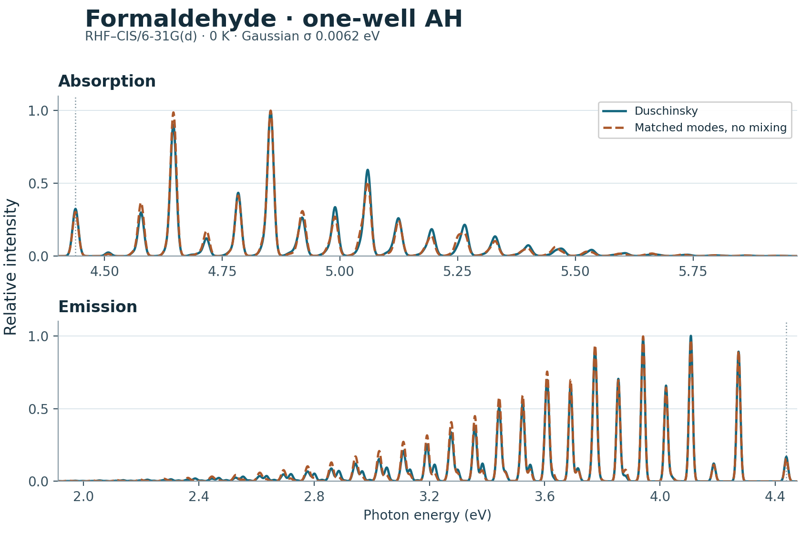
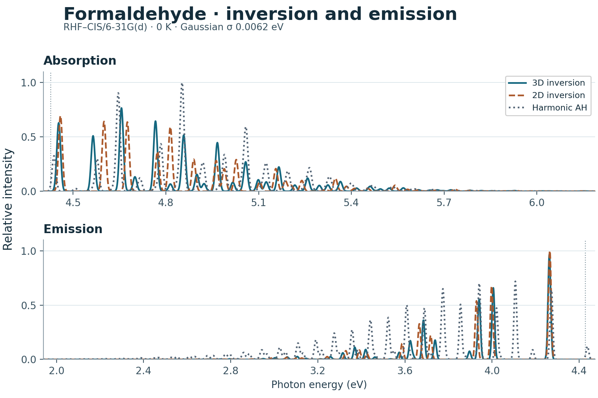
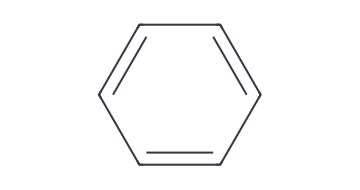
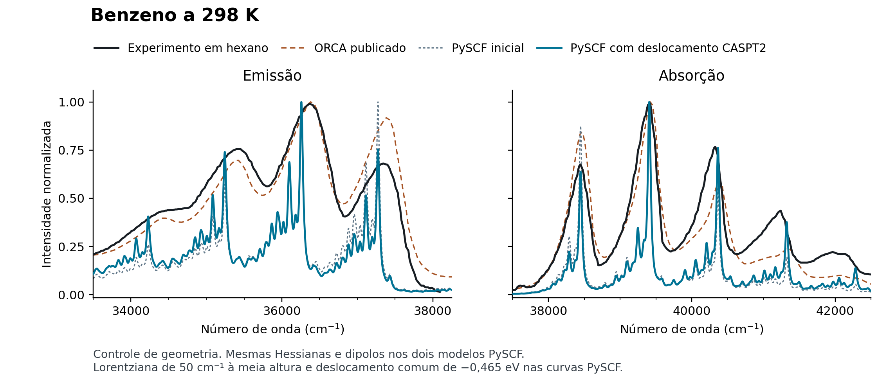
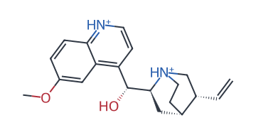
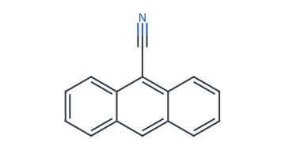
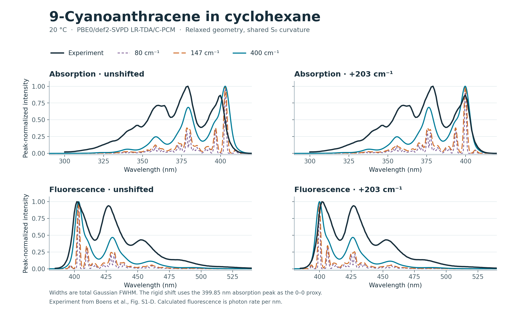
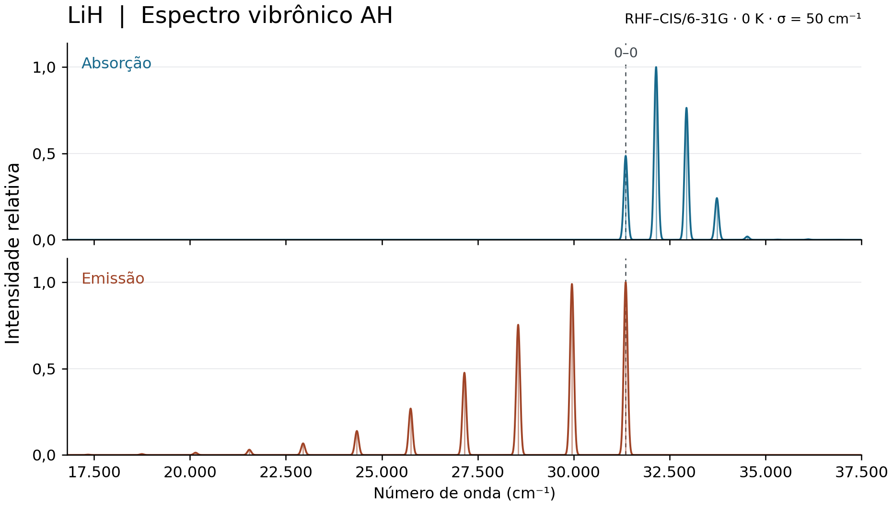

# PySCF ESD

**Excited-state dynamics for vibronic absorption, fluorescence, and phosphorescence.** PySCF ESD connects electronic structure, state tracking, and vibrational dynamics. Start from a molecular XYZ for automatic closed-shell absorption and fluorescence, or use `pyscf.esd` to assemble spectra from prepared electronic states, spin–orbit response, or explicitly anharmonic surfaces.

[](pyproject.toml)
[](https://pyscf.org/)
[](LICENSE)
[](docs/paper/pyscf-esd.pdf)

**[Quick start](#quick-start) · [Python](#use-as-a-pyscf-module) · [Choose a method](#default-and-options) · [Electronic structure and GPU](#electronic-structure-and-gpu) · [Nuclear dynamics](#nuclear-dynamics) · [Open shell and phosphorescence](#open-shell-spectra-and-phosphorescence) · [Numerical output](#output) · [Benchmarks and plots](#spectra-gallery) · [Methods paper](#methods-paper)**

## What PySCF ESD does

- **Follows the excited state.** The geometry optimizer tracks the electronic root and transition-dipole phase across changing orbital bases. SCF stability, response residuals, and stationarity are checked separately.
- **Builds both spectra from the two surfaces.** Adiabatic Hessian (AH) uses separate curvatures, Duschinsky rotation, and coherent Franck–Condon (FC) and Herzberg–Teller (HT) amplitudes. Vertical gradient (VG) provides a faster shared-curvature option.
- **Uses analytic response where implemented.** The NVIDIA workflow supports analytic VG and AH for compatible models. Prepared GPU LR-TDA/C-PCM roots expose analytic excited-state Hessians and dipole derivatives. CPU DFT AH qualifies its local fits against direct gradients and dipoles.
- **Treats large-amplitude motion explicitly.** Use automatic local DVR or VCI at qualified temperatures, a periodic torsion with a signed angle-dependent dipole and harmonic spectators, or prepared coupled coordinates for double wells and Fermi resonance.
- **Computes spin-resolved transitions.** Prepared UKS/TDA gives spin-conserving optical transitions. SF-TDA provides spin-flip response. Full-space spin–orbit response gives phosphorescence with analytic gas-phase spin-vibronic HT for an isolated triplet.
- **Reports physical observables.** Retrieve line assignments, oscillator strengths, radiative rates and lifetimes, Stokes shifts, relaxation energies, mode weights, and numerical coverage alongside the spectrum.

## Quick start

Use Python 3.10 or later on Linux or WSL. Clone the repository and install the workflow dependencies.

```bash
git clone https://github.com/HenriqueCSJ/PySCF_ESD.git
cd PySCF_ESD
python3 -m venv .venv
source .venv/bin/activate
python -m pip install '.[workflow]'

pyscf-esd examples/water.xyz --model vg --basis '6-31+g*' --output water.esd
```

The [bundled water input](examples/water.xyz) exercises the fast VG path. It writes absorption and emission sticks, Gaussian profiles, numerical properties, and convergence diagnostics. For an automatic calculation, supply a closed-shell molecular XYZ in ångström and a new output directory.

```bash
pyscf-esd molecule.xyz --output run.esd
pyscf-esd --help
```

The automatic run starts from a single geometry, uses the same electronic model on both surfaces, and targets the first singlet at the relaxed ground-state geometry. The input XYZ atom order carries through to the reported modes and derivatives. [Installation and command-line options](docs/guide.md)

## Use as a PySCF module

```python
from pyscf import esd, gto

mol = gto.M(atom="examples/water.xyz", basis="6-31+g*", unit="Angstrom")
result = esd.run(mol, xc="pbe0", model="vg")

absorption = result.spectra["absorption"]
emission = result.physical_properties["spectra"]["emission"]
if emission["coverage_status"] == "complete":
    print("Radiative rate (s^-1)", emission["vacuum_radiative_rate_s_inverse"])
    print("Radiative lifetime (s)", emission["vacuum_radiative_lifetime_s"])
```

`esd.run` uses the geometry, named basis, and charge of a built PySCF molecule. Supply real atoms, spherical all-electron basis functions, and `spin=0` for the automatic singlet route. Choose `target_index=1` for the second singlet in Python, or `--state 2` on the CLI. Indices follow the roots at relaxed S₀ and the optimizer tracks the assigned state from there.

Use `esd.Settings` with `esd.run_vibronic` to control the initial root count, grid level, SCF and response tolerances, or other advanced options. Lower-level APIs also accept derivatives, normal modes, dipoles, and model Hamiltonians from prepared data. [Python API](docs/api.md) · [Settings and units](docs/using-methods.md#choosing-the-level-of-theory)

## Default and options

The default is **CPU · PBE0/def2-TZVPD · first singlet at S₀ · 0 K · absorption and emission · `auto`**.

- **`auto`** relaxes both states, constructs an AH reference, and probes direct electronic cuts. It retains the harmonic model when the cuts qualify and uses a local anharmonic model when the evidence supports it. Thermal and transition coverage must qualify for each spectrum.
- **`ah`** uses harmonic wells at the two relaxed minima. It includes Duschinsky rotation and the coherent FC and linear HT terms. Use it to compare the same harmonic approximation across molecules or electronic methods.
- **`vg`** uses the S₀ curvature and the vertical excited-state gradient to define two harmonic wells of equal curvature. The CLI uses a constant transition dipole. Its emission comes from the emitting minimum of the VG model.
- **Prepared AH or FC/HT controls** start from supplied endpoints. Turn off HT by omitting the dipole derivatives. Use an identity Duschinsky map in `harmonic_spectrum` to study mode mixing, with mode correspondence and displacements expressed in a consistent frame.

```bash
# Choose the functional, basis, temperature, and linewidth
pyscf-esd molecule.xyz --model ah --xc b3lyp --basis def2-SVP \
  --temperature 298 --sigma 33.972872 --output ah-298.esd

# Second singlet, absorption sticks, no broadening
pyscf-esd molecule.xyz --state 2 --model vg --process absorption \
  --sigma 0 --output s2-absorption.esd

# Analytic GPU AH in equilibrium C-PCM
pyscf-esd molecule.xyz --backend gpu --model ah --solvent cyclohexane \
  --temperature 298 --output gpu-solution.esd
```

`--charge` sets the molecular charge. `--temperature` sets the thermal populations on the initial vibrational surface. `--sigma` is the Gaussian standard deviation in cm⁻¹. The first example uses 80 cm⁻¹ FWHM. `--max-quanta` and `--max-overlaps` set the vibrational budget. [Complete method guide](docs/using-methods.md) · [Choosing a solvent](docs/using-methods.md#choosing-a-solvent)

## Electronic structure and GPU

### Geometry optimization, state identity, and stability

1. **Prepare the ground reference.** Optimize S₀ with analytic gradients and check the closed-shell self-consistent solution. SCF retries can reuse projected orbitals or use a fresh solve. Independent residuals qualify the result.
2. **Follow the excited state.** Transition-density overlap across the two AO bases determines the state correspondence and sign. The excited-state optimizer uses analytic gradients, checks the local root window, and records the electronic identity through the optimization.
3. **Verify the endpoint.** Check stationarity and the projected vibrational curvatures. A geometry that looks chemically reasonable can still sit on a saddle or a different electronic root.
4. **Handle orbital instabilities.** The stability checks distinguish an internal RKS saddle from instability toward spin breaking. An internal recovery follows the unstable rotation and verifies a lower, stable solution. A spin-breaking failure can trigger an explicitly selected alternative functional, starting the full workflow again. Each attempt records its actual electronic method and state.
5. **Qualify the spectrum.** Grow the vibrational basis to check initial population and final dipole-strength coverage. An incomplete run reports the limiting check and can retain partial data for inspection.

`--reference-checks all` extends orbital checks to the electronic points along the workflow. Repeat `--fallback-xc XC` to define an ordered set of electronic models to try. State assignment must be checked separately under each functional. [Stability, recovery, and root tracking](docs/methods.md#electronic-reference-and-state-tracking) · [Reading an incomplete result](docs/guide.md#troubleshoot-an-incomplete-result)

The optimizer uses projected Cartesian BFGS with analytic gradients. A trial must pass the electronic checks and a downhill energy test after alignment. Failed trials shorten the step. The optimizer can restart with steepest descent, and the endpoint check can follow a downhill direction from a stationary point with negative curvature. The diagnostics count electronic and energy rejections separately. [Optimizer and minimum checks](src/pyscf_esd/electronic_workflow.py)

### Analytic derivatives by route

- **CPU VG.** Uses the analytic ground-state Hessian and excited-state gradient at S₀. The production VG route uses zero displaced electronic geometries. The matched water control verified the S₁ response at the requested tolerance of 10⁻¹⁰.
- **CPU DFT AH.** Uses analytic gradients, the analytic S₀ curvature, and checked local fits to displaced S₁ gradients and signed dipoles for excited-state curvature and HT. An optional fixed-geometry CPU API provides explicit central differences with signed root tracking and checkpointed samples.
- **CPU RHF–CIS controls.** Conventional real, all-electron singlet CIS supports analytic S₁ Hessian and dipole derivatives. LiH and formaldehyde qualify this route against independent checks. These retained controls are distinct from the DFT workflow.
- **GPU VG, AH, and automatic screening.** GPU VG supplies the analytic reference curvature and gradient. Supported GPU AH computes the two Hessians and phase-matched HT derivative analytically. `auto` can use the GPU for direct potential and dipole samples in the nuclear anharmonic model. Parts of assembly and the nuclear solver run on the host.
- **Prepared GPU LR-TDA, vacuum or equilibrium C-PCM.** The analytic Hessian includes orbital and TDA root response, auxiliary-basis and density-fitting derivatives, moving XC quadrature, fourth-order semilocal XC terms, and the matching solvent response where applicable. The dipole derivative includes the occupied and excitation response in the tracked electronic phase.

Use a compatible CUDA installation with GPU4PySCF. For analytic Hessians use supported global LDA/GGA functionals and spherical all-electron bases with the required DF and XC kernels. PBE0 has a built-in fourth XC derivative route. Other supported functionals can require a matching LibXC build via `PYSCF_ESD_LIBXC_LXC`. Backend and method support are checked when the response is requested. [GPU setup](docs/using-methods.md#gpu-vg-ah-and-automatic-screening) · [Explicit numerical derivative API](docs/using-methods.md#explicit-central-differences-on-cpu)

### Prepared electronic endpoints

The response functions work with solved, isolated singlet TDA roots at their corresponding geometries. Pass the same tracked excited state at both endpoints.

```python
from pyscf import esd

def endpoint_response(td_at_s0, root_at_s0, td_at_s1, root_at_s1, phase_at_s0):
    curvature = esd.analytic_molecular_tda_hessian(td_at_s1, root_at_s1)
    dipole = esd.analytic_tda_transition_dipole(td_at_s0, root_at_s0, phase=phase_at_s0)
    return curvature, dipole
```

The Hessian is the total excited-state Hessian. The excitation energy and gradient are corrections to the matching restricted reference at S₁. Use `esd.adiabatic_hessian` to combine the two endpoint energies, gradients, and Cartesian Hessians. It removes relative translation and rotation, projects the vibrational spaces, and returns the normal modes, Duschinsky map, and 0–0 energy. Project the Cartesian dipole derivative onto the signed modes before passing it to `esd.run_prepared_ah`. [Prepared C-PCM derivatives](docs/using-methods.md#analytic-derivatives-for-prepared-c-pcm-roots) · [Complete AH assembly example](docs/using-methods.md#spectra-from-prepared-electronic-data)

## Nuclear dynamics

### Harmonic absorption and fluorescence

AH relates the two sets of mass-weighted coordinates by $Q_1=JQ_0+K$. The rotation $J$ mixes modes, and $K$ describes their displacement. The 0–0 gap includes both the difference between the electronic minima and the differential zero-point energy. The FC term comes from the vibrational overlap with the constant dipole. The HT term comes from the signed first-order variation of the dipole along the modes. The amplitudes add before squaring, so the report can resolve FC, HT, and their interference.

The absorption calculation starts on S₀. Fluorescence starts on the relaxed emitting surface, reverses the Duschinsky transformation, and uses that surface's thermal populations. Absorption oscillator strengths carry one power of photon energy. Spontaneous photon rates carry three. These differences affect spectral shape, dominant lines, and the Stokes separation.

`harmonic_spectrum` returns assigned sticks from the selected basis. `thermal_harmonic_spectrum` evaluates broadened all-quanta FC/HT profiles with a characteristic function, including complex input amplitudes for spin–orbit spectra. It can return reduced dipole-strength density for comparison and the separate photon-weighted moment needed for absolute rates. [Harmonic theory and API](docs/methods.md#harmonic-vibronic-model) · [Thermal profiles](docs/numerical-results.md#thermal-profiles-and-prepared-rotors)

### Automatic local anharmonicity at finite temperature

- **One-mode DVR.** Direct samples on both surfaces determine a one-dimensional potential and signed dipole. The solver checks the finite-grid partition against a finer grid and a larger domain and checks confinement below the sampled well walls.
- **Local VCI.** Available cubic and quartic couplings enter a variational vibrational Hamiltonian. Fit holdouts, changes in basis size, and changes in the taper test the retained energies and states. At positive temperature the solver orders states by energy and bounds omitted Boltzmann weight.
- **Spectral coverage.** Initial thermal population and final dipole-strength closure are independent checks. Absorption and emission can reach different coverage under the same budget. Low barriers, competing minima, or strong couplings can require an explicitly prepared nuclear model.

```bash
pyscf-esd molecule.xyz --model auto --temperature 298 --process both \
  --output thermal-auto.esd
```

[Finite-temperature qualification](docs/using-methods.md#finite-temperature-anharmonicity) · [Automatic VCI implementation](src/pyscf_esd/automatic_anharmonic.py) · [One-mode implementation](src/pyscf_esd/automatic_1d.py)

### Prepared rotors, double wells, and resonances

**Periodic rotor with spectators.** Use two torsional potentials on a common energy zero and a signed vector transition dipole along the angle. The periodic DVR treats each surface with its own constant inertia. Signed state links around the full path determine closure. The code supports periodic and antiperiodic nuclear boundary conditions and checks the corresponding dipole parity. Rigid rotation is removed from the spectator mapping before combining harmonic spectator states with the rotor. This separates large-amplitude torsion from the other normal modes while retaining finite temperature, direction-specific populations, and spectator mode mixing.

```bash
# Synthetic rotor, with its own analytic checks and no electronic inputs
python examples/validate_anharmonic_rotor.py

# Molecular rotor from a caller-supplied phase-tracked archive
python examples/assemble_separable_rotor.py cuts.json --output rotor-298 \
  --temperature 298 --fwhm 80 --dvr-grids 256 512
```

**Double wells.** The prepared two-dimensional sine Galerkin and three-dimensional sine DVR solvers use sampled potentials in mass-weighted coordinates. Reflection-even and reflection-odd states can be separated and contracted with a coordinate-dependent dipole. The formaldehyde example includes the relaxed planar direction alongside inversion and distinguishes an electronic barrier from a separation between eigenstates.

**Fermi resonance.** `mix_vibrational_states` diagonalizes a supplied vibrational block and rotates signed Cartesian amplitudes with its eigenvectors. This gives intensity borrowing and coherent interference between a bright combination and a directly active fundamental. Prepared benzene examples compare a harmonic reference, a coupled three-mode model, removal of the cubic resonant term, and the effect of spectator couplings.

[Periodic rotor API and runnable Python example](docs/using-methods.md#thermal-torsion) · [Coupled-mode APIs](docs/api.md#reduced-coupled-vibrational-models) · [Vibrational state mixing](src/pyscf_esd/vibrational_mixing.py)

## Open-shell spectra and phosphorescence

### Unrestricted and spin-flip response

- **Prepared unrestricted DFT.** `analytic_uks_triplet_endpoint` returns the energy, analytic gradient, optional fixed-quadrature Hessian, orbital residual, and ⟨S²⟩ of a converged high-spin triplet. The supported gas-phase LDA/GGA route can use CPU PySCF or GPU4PySCF. Use consistent quadrature conventions when comparing geometries and curvatures.
- **Spin-conserving optical spectra.** `unrestricted_tda_vertical_spectrum` gives absorption or reverse emission from assigned UKS/TDA roots. It uses the reference's $M_S$ sector and exposes the reference spin diagnostic. The native unrestricted root's total spin requires a separate assignment.
- **Spin-flip TDA.** `solve_spin_flip_tda` starts from a converged high-spin GPU UKS reference. It exposes fixed-geometry root energies, orbital-relaxed interstate dipoles, and analytic state gradients through `spin_flip_tda_gradient`. Differences of the physical-root energies give the optical gap. A geometry-to-spectrum spin-flip workflow uses caller-tracked states, qualified curvatures, and the prepared spectral API.

[Open-shell and triplet APIs](docs/phosphorescence.md) · [Spin-flip Python examples and index conventions](docs/using-methods.md#spin-flip-tda-on-gpu)

### Spin–orbit intensity borrowing

The explicit state-interaction route builds molecular Breit–Pauli spin–orbit mean-field and interstate length-gauge dipoles from PySCF integrals. It mixes selected singlets and the three Cartesian spin components of each retained triplet. The result includes the mixed moments, sublevel-resolved radiative rates, and the population-weighted rate for a supplied temperature. With prepared matrix derivatives, `spin_orbit_dipole_derivatives` differentiates the coherently mixed moments.

```python
from pyscf import esd

def vertical_phosphorescence(rks_at_triplet_minimum):
    matrices = esd.run_pyscf_tda_soc(
        rks_at_triplet_minimum, n_singlets=12, n_triplets=12,
    )
    return matrices.phosphorescence(triplet_root=0, temperature_kelvin=77)
```

For weak SOC, `tda_soc_response` replaces the root-window sum with singlet and triplet resolvents over the occupied–virtual space. Its analytic gas-phase HT route differentiates the spin–orbit and dipole integrals, relaxed orbitals and density, both response operators, and the isolated lowest triplet. The two borrowing paths add coherently. The model uses the spin-free triplet degeneracy and first-order SOC. Use `run_prepared_phosphorescence` when supplying state-interaction matrices and AH data.

The SOMF implementation contracts Coulomb and exchange terms directly over AO shells. The derivative path batches nuclear directions and checks the individual orbital-response residuals. Projected adjoints supply the root and response changes needed for dipole slopes. The calculation evaluates those terms at one geometry. [SOMF derivative implementation](src/pyscf_esd/somf_derivatives.py) · [Orbital and TDA response](src/pyscf_esd/tda_nuclear_response.py)

[Explicit SOC assembly](docs/phosphorescence.md#automatic-soc-and-interstate-dipoles) · [Full-space response and thermal spectrum](docs/phosphorescence.md#full-space-first-order-soc-and-analytic-herzbergteller-coupling) · [Prepared vibronic phosphorescence](docs/phosphorescence.md#prepared-vibronic-phosphorescence)

## Output

### Files from the command line

- **`properties.json`** holds integrated strengths and physical observables from the retained transitions.
- **`absorption_sticks.csv` and `emission_sticks.csv`** hold assignments, energy, populations, dipole strengths, and the line oscillator strength or Einstein A coefficient.
- **`absorption_profile.csv` and `emission_profile.csv`** hold the optional Gaussian-broadened relative photon-weighted density. The CSV energy axis is in cm⁻¹. The code below converts the axis and the density to eV.
- **`diagnostics.json`** records the electronic reference, state and phase checks, derivative route, nuclear model, convergence, and separate coverage by direction. A known incomplete run can return partial sticks and a partial numerical summary.

### Read rates, lifetimes, and line strengths

```python
import json
from pathlib import Path

report = json.loads(Path("water.esd/properties.json").read_text(encoding="utf-8"))
for direction, spectrum in report["spectra"].items():
    print(direction, spectrum["coverage_status"])
emission = report["spectra"]["emission"]
if emission["coverage_status"] == "complete":
    print("k_f (s^-1)", emission["vacuum_radiative_rate_s_inverse"])
    print("Radiative lifetime (s)", emission["vacuum_radiative_lifetime_s"])
```

The equivalent Python report is `result.physical_properties`. The vacuum rate is the sum of Einstein coefficients weighted by the emitting vibrational populations. Its reciprocal is the radiative lifetime for a positive rate. The measured decay time and quantum yield also depend on nonradiative processes. The vacuum prefactor applies to the reported rate even when the electronic calculation uses C-PCM.

Where the model supplies them, the numerical reports include:

- Population-weighted oscillator strengths and dipole strengths, radiant power, and contributions from individual initial vibrational states.
- The 0–0 origin, strongest sticks, centroids, energy variances, and three distinguishable Stokes separations from the sticks or broadened peaks.
- The two vertical energies, adiabatic electronic gap, relaxation and deformation energies, and differential zero-point correction.
- Signed mode displacements, Huang–Rhys factors, mode-resolved reorganization energies, and the Duschinsky matrix.
- FC and HT strengths, signed interference, mean occupation of final modes, and their share of the signal.

### Plot a profile in eV

After running the quick start, install NumPy and Matplotlib if needed. Plot both files on their native energy axes.

```python
from pathlib import Path

import matplotlib.pyplot as plt
import numpy as np

cm_per_ev = 8065.54393734921
for process in ("absorption", "emission"):
    filename = Path("water.esd") / f"{process}_profile.csv"
    wavenumber, density = np.loadtxt(filename, delimiter=",", skiprows=1).T
    plt.plot(wavenumber / cm_per_ev, density * cm_per_ev, label=process.capitalize())
plt.xlabel("Photon energy (eV)")
plt.ylabel("Relative photon-weighted density per eV")
plt.legend()
plt.show()
```

[Numerical schema, units, and examples](docs/numerical-results.md) · [Coverage and diagnostics](docs/guide.md#read-the-output)

## Spectra gallery

The benchmark figures cover distinct observables and comparison protocols. The captions give the electronic model, linewidth, and alignment when they matter. Absolute-energy calculations and display alignments are kept distinct. The [molecular structure plate](docs/paper/pyscf-esd.pdf#page=2) shows the nine systems in the methods paper. Earlier figures retain their original cm⁻¹ or wavelength axes. The added control panels use eV.

### Numerical controls before spectral comparisons

<details open>
<summary><strong>Water · matched CPU and RTX 4070 Laptop GPU</strong></summary>

Both PBE0/6-31+G* analytic VG paths produced **9,100 assigned lines in each direction** at 298.15 K and passed 16 numerical checks. The largest line-energy differences were **1.13 × 10⁻⁵ cm⁻¹** in absorption and **1.04 × 10⁻⁵ cm⁻¹** in emission. The maximum S₀ Hessian discrepancy was **7.04 × 10⁻¹¹ Hartree/bohr²**. Verification of a CPU orbital-response correction gave an S₁ residual of **8.51 × 10⁻¹¹** at the requested 10⁻¹⁰ tolerance. The production calculation uses analytic derivatives at the supplied ground geometry.

The warmed three-run medians were **21.37 s on two CPU threads** and **36.80 s on the RTX 4070 Laptop GPU**. For this system, a separate timing profile explained most of the extra GPU time through SCF/TDA setup, response validation, and orbital stability checks. The same benchmark measures both numerical agreement and wall time.

```bash
python examples/validate_water_cpu.py water-validation --threads 2
python examples/validate_water_gpu.py water-validation/reference.json \
  water-gpu-report.json --threads 2 --repeats 3
```

Add `--stencil` to the CPU control to compare the analytic gradient with independent displaced points. [Matched benchmark and tolerances](docs/validation.md#water-cpu-and-gpu)

</details>

<details open>
<summary><strong>Formaldehyde · analytic AH, Duschinsky rotation, and inversion</strong></summary>

The RHF–CIS/6-31G(d) control compares the analytic polyatomic S₁ Hessian with independent gradient stencils. The maximum Cartesian discrepancy was **1.84 × 10⁻⁶ Hartree/bohr²**. Both harmonic profiles use the same signed linear HT model and Gaussian σ of 0.0062 eV. The matched-mode comparison holds the ground-frame displacement fixed while suppressing mode mixing.



The separate inversion calculation uses both symmetry-related S₁ wells and the transition dipole along the inversion coordinates. Adding a third coordinate to describe planar relaxation lowers the direct electronic barrier from **0.03459 to 0.01660 eV** (279.00 to 133.90 cm⁻¹). The lowest even–odd interval moves from **0.02785 to 0.02626 eV** (224.65 to 211.84 cm⁻¹). The lowest level is close to the effective transverse barrier. These intervals describe the coupled nuclear solutions. The odd dipole in the parity model gives an electrically dark even-to-even 0–0 line.



Both plots use retained curves with the photon-energy axis expressed in eV and one common intensity normalization within each panel. The vertical dotted line marks the 0–0 energy for the corresponding AH or 3D inversion model. [Analytic AH replay](examples/validate_h2co_analytic_ah.py) · [Two-coordinate inversion](examples/validate_h2co_inversion.py) · [Three-coordinate inversion](examples/validate_h2co_3d.py) · [Model and barrier definitions](docs/validation.md#formaldehyde-inversion)

</details>

### Molecular comparisons and sensitivity studies

<details open>
<summary><strong>Benzene · n-hexane · geometry sensitivity and anharmonicity</strong></summary>

<p>
  
</p>



Replacing the symmetric breathing displacement in the B3LYP5/TDA model with a published geometry-derived value changes the fluorescence peak ratio from **1.013 to 0.754**, versus **0.688** measured. The two calculations share the same Hessians, dipole model, origin, Lorentzian width and display shift. [Published CASPT2 geometries](https://doi.org/10.1063/1.480854)


The PBE anharmonic model reproduces the three main fluorescence bands and reduces the profile RMSE by **38%** relative to the harmonic control at the same adjusted width. The PBE anharmonic RMSE is **0.063** in absorption and **0.081** in fluorescence, versus **0.085** and **0.071** for the published comparison. [de Souza et al., Fig. 3](https://doi.org/10.1063/1.5010895)

</details>

<details open>
<summary><strong>Benzene in the gas phase · Fermi resonance and the signed ν₈ dipole</strong></summary>

The ν₈ fundamental and the ν₁+ν₆ combination share the symmetry needed to mix in S₀. The experimental fluorescence peaks are at **36,475 and 36,494 cm⁻¹**, separated by **2.36 meV**. In the three-coordinate B3LYP/TDA replay, the coupled anharmonic pair is separated by **2.67 meV**. The replay also tests a harmonic model and removal of the explicit cubic coupling. The active-space computed origin and the measured-origin comparison are tracked separately.


The plotted Raman-parametrized control tests the effect of adding the direct ν₈ amplitude with either sign. The low/high peak-height ratio rises from **0.884** without the direct amplitude to **1.317** with the positive relative sign, and falls to **0.591** with the negative sign. The experimental figure gives an estimated peak-height ratio of about **1.17**. The vertical markers are the measured maxima. This test establishes the sensitivity to coherent interference under the stated amplitude assumption. The electronic determination of the bare relative phase and measurement of the band areas are separate questions.

[Three-coordinate calculation](examples/validate_benzene_3d.py) · [Experimental comparison](examples/compare_benzene_experiment.py) · [Spectator and breathing-mode controls](examples/validate_benzene_spectator_mixing.py) · [Measured fluorescence](https://doi.org/10.1021/ja00841a001) · [Raman parametrization](https://doi.org/10.1016/j.jms.2013.05.005)

</details>

<details open>
<summary><strong>CF₃NO · periodic rotor and 11 harmonic spectators</strong></summary>


The periodic CF₃ rotor recovers the low-frequency progression and broad absorption envelope after alignment to the measured jet origin. The peak-to-origin interval is **498.50 cm⁻¹**, compared with **499.90 cm⁻¹** measured. The PySCF curves at 298 K use Gaussian FWHM **80 cm⁻¹**, and fluorescence retains the computed photon-rate density. The article reports the reference-stability test and the native energy offset alongside this nuclear benchmark. [Hage et al.](https://doi.org/10.1021/acsomega.6c11480)


The 0 K panel shows the native energy axis and absolute spectral densities with Gaussian **σ = 50 cm⁻¹**. The common 0–0 origin separates the main absorption and fluorescence bands.


The single-coordinate diagnostic holds the signed, angle-dependent dipole fixed and compares a local harmonic well with a periodic rotor at 298.15 K. Both curves in each direction share one normalization and Gaussian σ of 0.00062 eV. The room-temperature benchmark above adds the **11 harmonic spectators** and uses a distinct retained electronic input and linewidth.

The **PBE0/TDA** model is the default in the archived CF₃NO replay. **SF-TDA** is selectable. The restricted PBE0 reference has a known spin-breaking instability, so the closer matched-origin envelope is evidence for the nuclear model under those inputs. At 298 K its native absorption maximum is **1.695 eV**, versus **1.789 eV** from the measured trace. The peak-to-origin interval agrees to **1.40 cm⁻¹** (0.17 meV). The published harmonic comparison places too much strength in a few bands. The periodic rotor captures the low-frequency structure and redistributes intensity across the envelope. [Published comparison](https://doi.org/10.1021/acsomega.6c11480) · [Reference checks](docs/validation.md#cf₃no-at-298-k) · [Replay driver](examples/replay_cf3no_thermal.py)

```bash
python examples/replay_cf3no_thermal.py PATH_TO_ARCHIVE --output replay-pbe0
python examples/replay_cf3no_thermal.py PATH_TO_ARCHIVE --method sf-tda --output replay-sf
```

</details>

<details>
<summary><strong>Quinine dication · water · AS–Franck–Condon</strong></summary>

<p>
  
</p>


The broadened absorption maximum is **3.606 eV** before alignment, compared with **3.568 eV** in the experiment. A display shift of **−0.496 eV** brings the calculated fluorescence envelope close to the measured one. The unshifted peak separation in the energy-domain plot is **0.41 eV**, compared with **0.85 eV** measured. Retesting the widths retained **0.496 eV** for absorption and **0.397 eV** for fluorescence. The 50-atom pilot used one conformer in implicit water. Its relaxed S₁ geometry met the force criterion and gave stable successive spectra. The strict geometry convergence cycle was incomplete. [PhotochemCAD measurement in 0.5 M aqueous H₂SO₄](https://omlc.org/spectra/PhotochemCAD/html/081.html)

The native fluorescence maximum is **3.199 eV**, versus **2.716 eV** measured on the energy-domain plot. The two endpoint dipoles use different response conditions as documented in the paper. The comparison reports both the aligned shape and the native peak separation.

</details>

<details>
<summary><strong>9-Cyanoanthracene · cyclohexane · AS–Franck–Condon</strong></summary>

<p>
  
</p>



The wavelength-domain comparison shows Gaussian FWHM values of **80**, **147**, and **400 cm⁻¹**, both on the native axis and with a common **+203 cm⁻¹** shift. The red absorption band carries too much relative intensity at all three linewidths. [Boens et al., supporting Fig. S1-D, CC BY-NC 4.0](https://doi.org/10.1021/ac062160k.s001)

The independent solvated **analytic AH+HT** comparison retains the same relaxed geometries and uses separate curvatures. At **0.0099 eV FWHM** on the native axis, the leading fluorescence band-area ratio changes from **0.69** with AS–FC to **1.37** with AH+HT, compared with **1.21** measured. The native peak positions move farther from experiment. The control separates the gain in relative intensities from the change in energy placement. [Methods paper and quantitative benchmark](docs/paper/pyscf-esd.pdf)

</details>

<details>
<summary><strong>Pyridine · vapor · AH + Duschinsky + Herzberg–Teller</strong></summary>

<p>
  
</p>


The local harmonic origin is **4.217 eV** versus **4.311 eV** measured. The comparison retains Gaussian FWHM values of **0.010** and **0.020 eV**, with display shifts of **−0.127** and **+0.356 eV** for absorption and fluorescence. A shallow out-of-plane well and evolving electronic character limit the local model. [Experimental vibronic origin](https://doi.org/10.1016/j.cplett.2008.07.080) · [Absorption](https://doi.org/10.1016/0022-2852(84)90051-1) · [Fluorescence trace](https://doi.org/10.1063/1.433862) · [Traced through Wang et al.](https://doi.org/10.1021/acs.jpclett.2c01475)

The calculated integrated absorption oscillator strength is **0.00735**, compared with about **0.003** measured. The local soft-mode zero-point energy exceeds the electronic barrier by more than two orders of magnitude. The plotted AH spectrum describes one well.

</details>

<details>
<summary><strong>Lithium hydride · one-mode analytic AH control</strong></summary>



This archived RHF–CIS/6-31G test exercises the analytic derivatives and AH assembly with independent curvatures. At 0 K the strongest absorption line lies one excited-state harmonic quantum above the common 0–0 origin. Fluorescence peaks at the origin.

The analytic excited-state bond curvature is **0.020890425 Hartree/bohr²**. The independent gradient stencil gives **0.020890370 Hartree/bohr²** for that coordinate. The two profiles share a **3.8875 eV** origin. [Derivative validation](docs/validation.md#analytic-excited-state-derivatives) · [LiH replay](examples/validate_lih_analytic_ah.py)

</details>

<details open>
<summary><strong>Naphthalene · 77 K · spin–orbit phosphorescence</strong></summary>


Full-space spin–orbit response recovers the dominant perpendicular emission. Gas-phase AH with analytic spin-vibronic Herzberg–Teller coupling predicts a **15.54 s radiative lifetime** and **88.5% perpendicular emission**. Two ground-state ring fundamentals produce the calculated split. The matched Condon dielectric control leaves their separation near **0.025 eV** and shortens the radiative lifetime from **17.62 to 15.84 s**. The panels use each spectrum's own 0–0 energy as the origin for energy loss. [Benchmark and numerical data](docs/phosphorescence.md#naphthalene-benchmark) · [Glass spectrum](https://pstorage-acs-6854636.s3.amazonaws.com/6569049/jp6b07709_si_001.pdf)

The original 12+12 Condon window gives **0.00260 s⁻¹**. Including all **4,964 spatial configurations per spin** raises it to **0.05676 s⁻¹** and recovers the perpendicular channel. Gas-phase HT raises the rate further to **0.06437 s⁻¹**. At the same Gaussian width of 0.0186 eV, mean dielectric response shifts each of the underlying fundamentals by less than 3 cm⁻¹. Using the independently read experimental 0–0 linewidth in a resolution check merges the calculated peaks, while the merged band remains about 0.013 eV farther from the origin than measured. The C-PCM comparison uses the Condon model and a methylcyclohexane dielectric proxy.

[Gas Condon profile](docs/benchmarks/naphthalene/gas-condon-77k.csv.gz) · [Gas analytic HT profile](docs/benchmarks/naphthalene/gas-ht-77k.csv.gz) · [C-PCM Condon profile](docs/benchmarks/naphthalene/pcm-condon-77k.csv.gz) · [Line assignments](docs/benchmarks/naphthalene/gas-assignments.json) · [Solvent and linewidth diagnostics](docs/benchmarks/naphthalene/glass-diagnostic.json)

</details>

<details>
<summary><strong>Naphthalene fluorescence at 298 K · singlet-state intensity borrowing</strong></summary>

The cyclohexane fluorescence study probes mixing of the two low-lying singlets using one promoter coordinate and 47 harmonic spectators. The conditional radiative rate falls from **2.01 × 10⁸ s⁻¹** in the linear one-state model to **2.27 × 10⁷ s⁻¹** with explicit B3LYP5 two-state nuclear coupling. Substituting ωB97X active-mode energies and dipoles at the retained geometries gives **6.87 × 10⁶ s⁻¹**, versus about **2.40 × 10⁶ s⁻¹** measured. This is a separate benchmark from the 77 K triplet. [Methods paper](docs/paper/pyscf-esd.pdf) · [Experimental comparison](https://doi.org/10.1063/1.5010895)

</details>

## Experimental prepared-reference tools

<details>
<summary><strong>ROKS stability, OpenQP/MRSF checkpoint adapters, and archived SA-CASSCF controls</strong></summary>

- **ROKS diagnostics.** Inspect fresh spin Focks, the real shared-orbital curvature, and continuity of separate occupied classes. A triplet H₄ control checks the real rotation Hessian. Cross-engine stability checks need the native integration quadrature and an independently verified equivalent fixed-orbital reference.
- **MRSF and OpenQP prepared checkpoints.** The adapter decodes response vectors, reconstructs signed state densities and interstate dipoles, preserves the raw AO convention, and evaluates cross-geometry overlaps through directed determinant blocks. In the synthetic six-root control, the four-block overlap agrees with the explicit determinant contraction within 2.78 × 10⁻¹⁵. The warmed single-thread medians were 3.93 ms and 1.17 s for that overlap alone. Full-loop tracking from independently optimized checkpoints and production CF₃NO spectra remain open.
- **SA-CASSCF research interface.** The archived wavefunction work provides a checked state-specific analytic gradient and overlap tracking from a prepared state-averaged reference. Active-space enlargement recovered local continuity through two rejected geometries. The complete torsion scans did not finish. These modules are separate from the DFT workflow.

[Prepared-reference APIs](docs/api.md#pyscf-adapters) · [MRSF and ROKS controls](docs/validation.md#archived-mixed-reference-tddft-investigation) · [Archived wavefunction controls](docs/validation.md#archived-wavefunction-investigation)

</details>

## Reproduce and extend

```bash
python -m pip install -e '.[workflow]'
OMP_NUM_THREADS=2 OPENBLAS_NUM_THREADS=1 python -m unittest discover -s tests -v
python examples/validate_anharmonic_rotor.py
```

The tests exercise analytic oscillator and rotor limits, signed and complex dipole closure, relative phases around periodic paths, state identity and orbital stability, response derivatives, CPU/GPU comparisons, and incomplete-workflow behavior. GPU integration checks use the relevant CUDA and XC support.

Start with the [validation guide](docs/validation.md) to pick a replay. Water and the synthetic rotor have runnable inputs in the checkout. The larger molecular replays use caller-supplied retained electronic data. The three naphthalene spectra are available in native eV along with their diagnostic reports. To judge agreement, compare the same observable, broadening, units, polarization, and reference energy. Vibrational coverage measures numerical completeness within the model.

### Source map

- [Workflow and electronic preparation](src/pyscf_esd/workflow.py), [state tracking](src/pyscf_esd/state_tracking.py), and [CPU electronic response](src/pyscf_esd/cpu.py)
- [GPU VG](src/pyscf_esd/gpu.py), [analytic molecular Hessian](src/pyscf_esd/molecular_tda_hessian.py), [transition dipole derivatives](src/pyscf_esd/tda_dipole.py), and [SF-TDA](src/pyscf_esd/gpu_spin_flip.py)
- [Harmonic sticks](src/pyscf_esd/harmonic.py), [thermal harmonic and separable profiles](src/pyscf_esd/thermal_separable.py), [anharmonic DVR](src/pyscf_esd/anharmonic_dvr.py), and [periodic phase and dipole sampling](src/pyscf_esd/anharmonic_sampling.py)
- [Prepared SOC matrices](src/pyscf_esd/pyscf_soc.py), [full-space spin–orbit response](src/pyscf_esd/tda_soc_response.py), [vibronic phosphorescence](src/pyscf_esd/phosphorescence.py), and [physical observables](src/pyscf_esd/spectral_properties.py)

## Methods paper

The [methods paper PDF](docs/paper/pyscf-esd.pdf) presents the electronic and nuclear equations, nine molecular structures, a quantitative comparison, and the selected spectra. The [LaTeX source](docs/paper/main.tex), [electronic methods](docs/paper/electronic.tex), and [nuclear methods](docs/paper/nuclear.tex) are included.

```bash
latexmk -cd -pdf docs/paper/main.tex
```

[Installation and CLI](docs/guide.md) · [Method guide](docs/using-methods.md) · [Python API](docs/api.md) · [Numerical outputs](docs/numerical-results.md) · [Validation](docs/validation.md) · [GPL-3.0-only](LICENSE)
