# Spectra gallery

[Project home](../README.md) · [Benchmark methods](validation.md) · [Methods paper](paper/pyscf-esd.pdf)

The captions give the linewidth and energy reference for each plot. Pyridine and quinine retain the absolute absorption scale. Each plot uses the axis and comparison settings of its benchmark.

<strong>Benzene · n-hexane · geometry sensitivity and anharmonicity</strong>

  

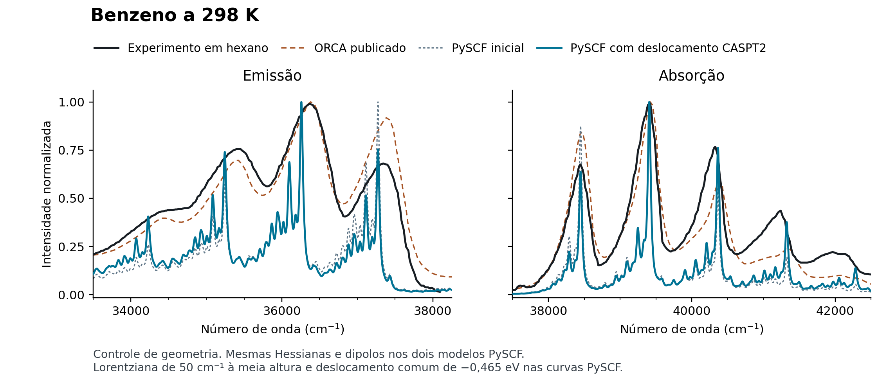

Replacing the symmetric breathing displacement in the B3LYP5/TDA model with a published geometry-derived value changes the fluorescence peak ratio from **1.013 to 0.754**, versus **0.688** measured. The two calculations share the same Hessians, dipole model, origin, Lorentzian width and display shift. [Published CASPT2 geometries](https://doi.org/10.1063/1.480854)

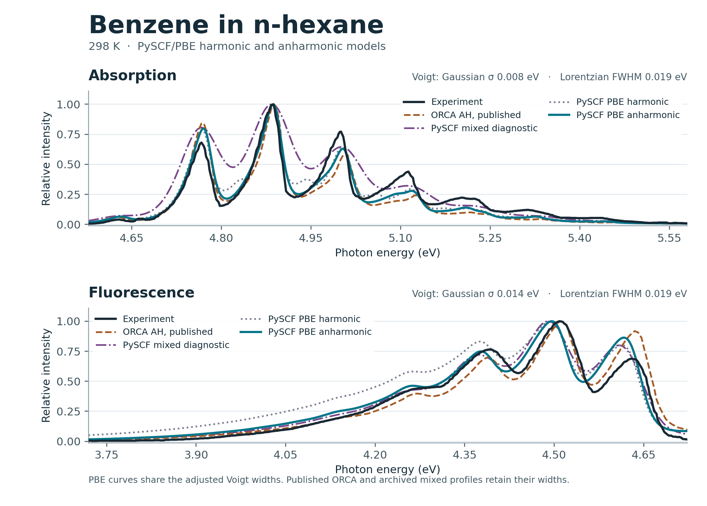

The PBE anharmonic model reproduces the three main fluorescence bands and reduces the profile RMSE by **38%** relative to the harmonic control at the same adjusted width. The PBE anharmonic RMSE is **0.063** in absorption and **0.081** in fluorescence, versus **0.085** and **0.071** for the published comparison. [de Souza et al., Fig. 3](https://doi.org/10.1063/1.5010895)

<strong>CF₃NO · periodic rotor and 11 harmonic spectators</strong>

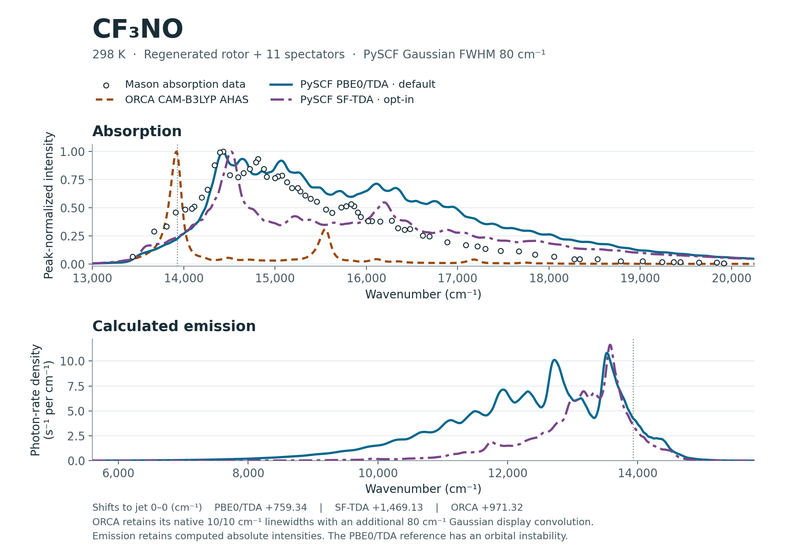

The periodic CF₃ rotor recovers the low-frequency progression and broad absorption envelope after alignment to the measured jet origin. The peak-to-origin interval is **498.50 cm⁻¹**, compared with **499.90 cm⁻¹** measured. The PySCF curves at 298 K use Gaussian FWHM **80 cm⁻¹**, and fluorescence retains the computed photon-rate density. The article reports the reference-stability test and the native energy offset alongside this nuclear benchmark. [Hage et al.](https://doi.org/10.1021/acsomega.6c11480)

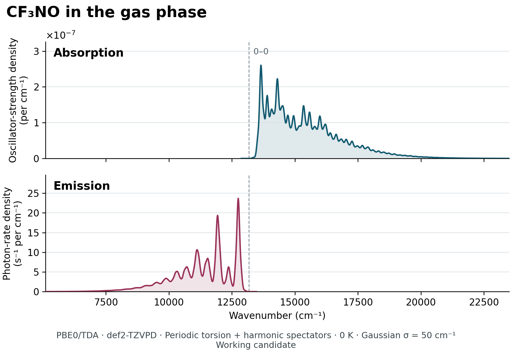

The 0 K panel shows the native energy axis and absolute spectral densities with Gaussian **σ = 50 cm⁻¹**. The common 0–0 origin separates the main absorption and fluorescence bands.

<strong>Quinine dication · water · AS–Franck–Condon</strong>

  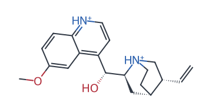

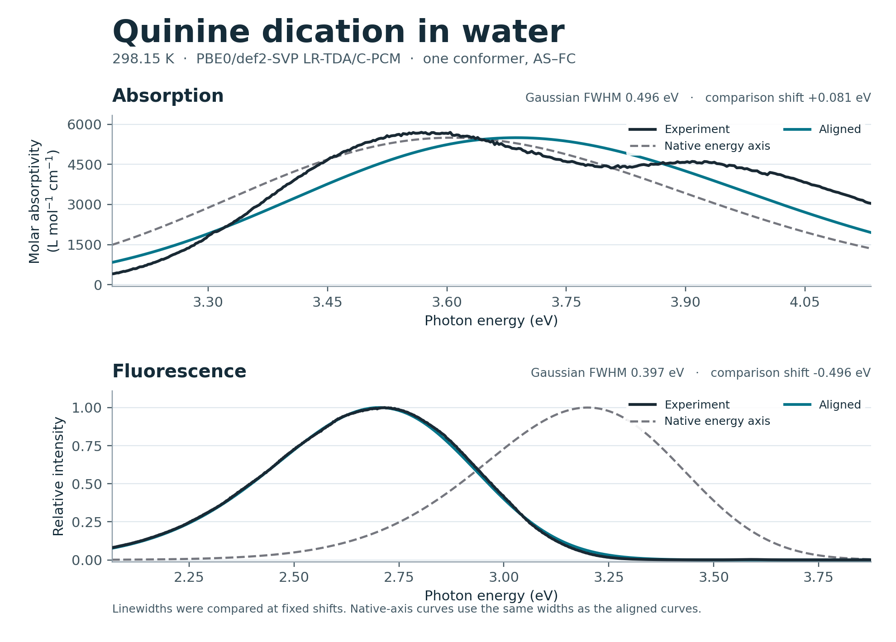

The broadened absorption maximum is **3.606 eV** before alignment, compared with **3.568 eV** in the experiment. A display shift of **−0.496 eV** brings the calculated fluorescence envelope close to the measured one. The unshifted peak separation in the energy-domain plot is **0.41 eV**, compared with **0.85 eV** measured. Retesting the widths retained **0.496 eV** for absorption and **0.397 eV** for fluorescence. The 50-atom pilot used one conformer in implicit water. Its relaxed S₁ geometry met the force criterion and gave stable successive spectra. The strict geometry convergence cycle was incomplete. [PhotochemCAD measurement in 0.5 M aqueous H₂SO₄](https://omlc.org/spectra/PhotochemCAD/html/081.html)

<strong>9-Cyanoanthracene · cyclohexane · AS–Franck–Condon</strong>

  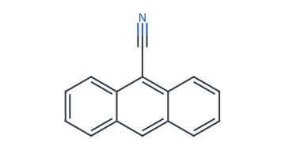

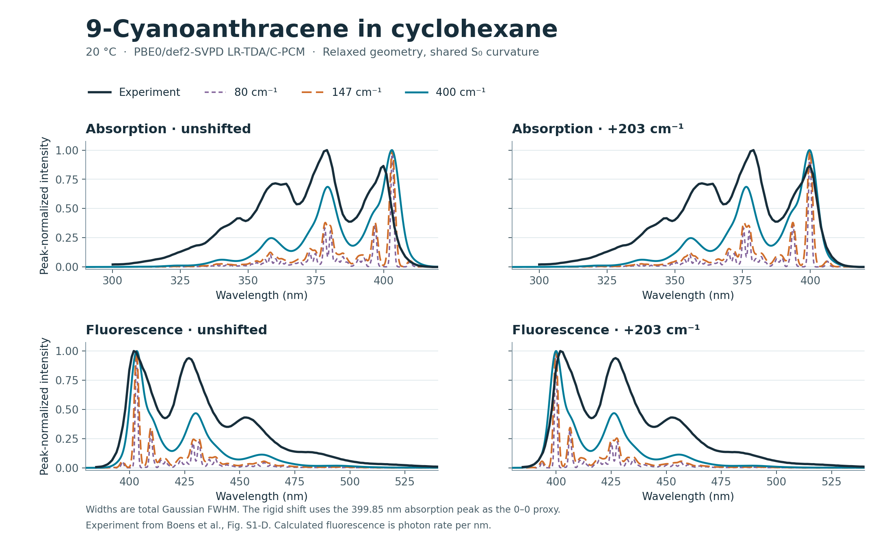

The wavelength-domain comparison shows Gaussian FWHM values of **80**, **147**, and **400 cm⁻¹**, both on the native axis and with a common **+203 cm⁻¹** shift. The red absorption band carries too much relative intensity at all three linewidths. [Boens et al., supporting Fig. S1-D, CC BY-NC 4.0](https://doi.org/10.1021/ac062160k.s001)

<strong>Pyridine · vapor · AH + Duschinsky + Herzberg–Teller</strong>

  

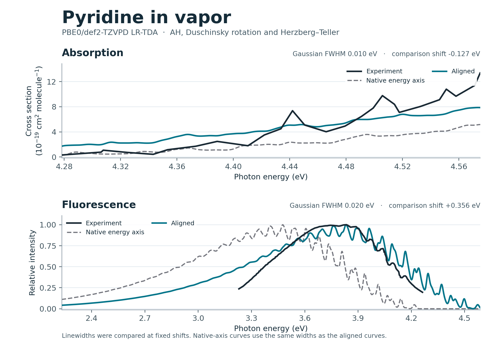

The local harmonic origin is **4.217 eV** versus **4.311 eV** measured. The comparison retains Gaussian FWHM values of **0.010** and **0.020 eV**, with display shifts of **−0.127** and **+0.356 eV** for absorption and fluorescence. A shallow out-of-plane well and evolving electronic character limit the local model. [Experimental vibronic origin](https://doi.org/10.1016/j.cplett.2008.07.080) · [Absorption](https://doi.org/10.1016/0022-2852(84)90051-1) · [Fluorescence trace](https://doi.org/10.1063/1.433862) · [Traced through Wang et al.](https://doi.org/10.1021/acs.jpclett.2c01475)

<strong>Lithium hydride · one-mode analytic AH control</strong>

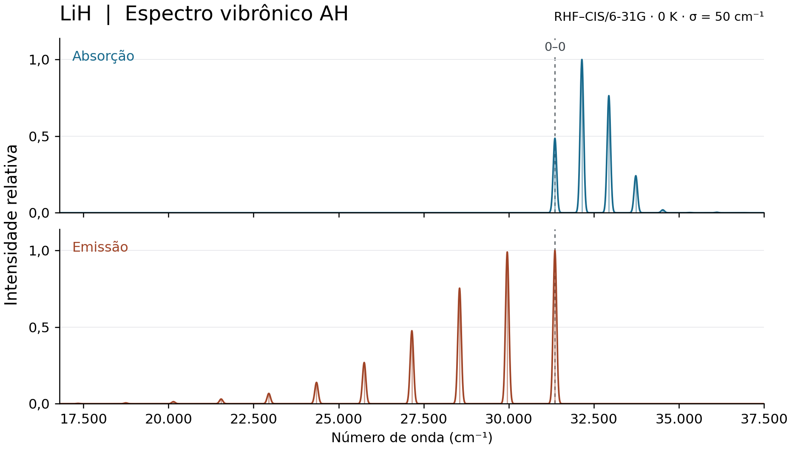

This archived RHF–CIS/6-31G test exercises the analytic derivatives and AH assembly with independent curvatures. At 0 K the strongest absorption line lies one excited-state harmonic quantum above the common 0–0 origin. Fluorescence peaks at the origin.

<strong>Naphthalene · 77 K · spin–orbit phosphorescence</strong>

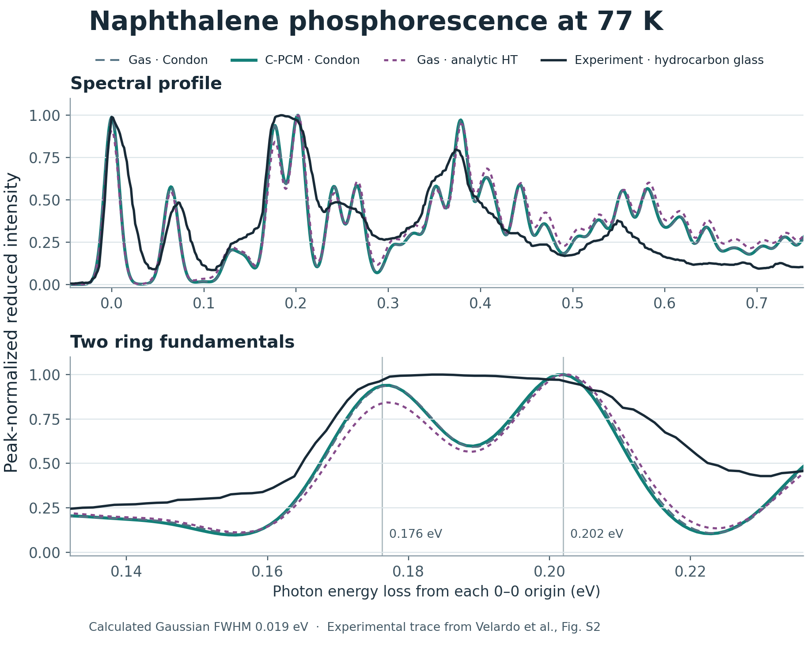

Full-space spin–orbit response recovers the dominant perpendicular emission. Gas-phase AH with analytic spin-vibronic Herzberg–Teller coupling predicts a **15.54 s radiative lifetime** and **88.5% perpendicular emission**. Two ground-state ring fundamentals produce the calculated split. The matched Condon dielectric control leaves their separation near **0.025 eV** and shortens the radiative lifetime from **17.62 to 15.84 s**. The panels use each spectrum's own 0–0 energy as the origin for energy loss. [Benchmark and numerical data](phosphorescence.md#naphthalene-benchmark) · [Glass spectrum](https://pstorage-acs-6854636.s3.amazonaws.com/6569049/jp6b07709_si_001.pdf)

